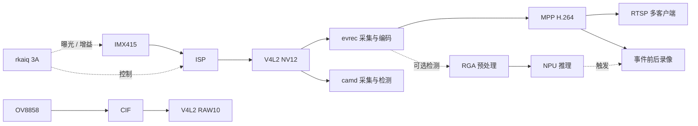

# RK3568 相机驱动与事件视频服务

基于 RK3568 和 Linux 4.19 厂商 BSP 的相机实践项目：接入 IMX415 与 OV8858，探索 V4L2 采集、传感器驱动、H.264 事件录像和 RTSP 推流，并保留调试过程中的失败与验证记录。

主应用使用 IMX415 完成人体事件录像与 RTSP；OV8858 是传感器驱动与 RAW 采集验证支路。项目重点是**相机数据从驱动到应用的实现，以及问题的分层定位**。各模块用途、取舍及待冻结版本见[最终系统设计](docs/overview/final-system.md)。

[文档索引](docs/README.md) · [系统架构](docs/overview/architecture.md) · [启动故障与恢复](docs/runbook/boot-recovery.md) · [测试与验证范围](docs/acceptance/summary.md)

## 系统结构



`evrec` 与 `camd` 是不同程序，图中表示各自的数据路径，不表示它们可以同时独占同一采集节点。OV8858 经 CIF 输出 RAW10；IMX415 经 ISP 输出 NV12。

`mini3a` 是 IMX415 上另一套简化 AE/AWB 实验，和 `rkaiq` 不应同时控制该链路；OV8858 RAW10 则可用于原始保存及离线分析。[AE/AWB 实验入口](mini3a/README.md) · [两路格式与处理](docs/pipeline/dual-camera.md)

## 主要实现与问题

- **相机驱动与采集：** OV8858 V4L2 subdev 驱动包含 I²C 寄存器访问、上电时序、格式和开关流等路径。调试时曾因实际物理口与假设的 I²C 总线不一致而走弯路；核对接线和设备拓扑后再定位问题。[驱动源码](driver/ov8858_sm/ov8858_sm.c) · [I²C 排障记录](docs/bringup/i2c-debug.md) · [寄存器与厂商驱动对照](docs/bringup/driver-comparison.md)
- **事件录像与流媒体：** `evrec` 将编码数据写入有界环形缓冲，按事件保存前后片段；`rtsp_hub` 为客户端维护独立游标，并处理慢客户端。[事件录像](tools/evrec.c) · [RTSP 实现](tools/rtsp_hub.c) · [录像设计与验证](docs/pipeline/event-recording.md)
- **录像示例：** [观看 MP4](evidence/2026-11-06-event-demo/event.mp4) · [板端录像与封装记录](evidence/2026-11-06-event-demo/README.md)。示例为手动触发；MP4 使用近似帧率封装。
- **线程与缓冲区：** `camd` 使用有界队列将采集帧交给消费者，并通过引用计数管理 V4L2 buffer 的归还。采集、检测和事件处理的容量与失败恢复是独立问题。[采集与队列源码](tools/camd.c) · [可靠性记录](docs/stability/reliability.md)
- **内核问题定位：** 基于启动日志与调用链，定位并修复了传感器格式协商触发的内核空指针异常；记录还覆盖运行时电源管理和错误路径。[启动 panic 复盘](docs/runbook/boot-recovery.md) · [内核问题记录](docs/stability/kernel-issues.md)

## 快速开始

`evrec` 和 `camd` 依赖 Rockchip MPP、RGA、RKNN 头文件与运行库；在依赖齐全的目标 Linux 环境中可运行：

```bash
make apps
```

构建选项见 [Makefile](Makefile)。OV8858 驱动在历史 BSP 中内建，不能套用通用的 `insmod` 示例；源码编译、部署和板测是不同步骤。设备节点、模型、工具链和服务版本以现场检查为准，历史命令见[环境与复现说明](docs/acceptance/reproduction.md)。

不接板时，可在 Linux 主机运行 `python3 tools/tests/test_evrec_preload.py` 检查事件收尾的文件错误路径；这是主机替身测试，不能当作真实相机或设备路径已验证。

一次 IMX415 现场采集的[原始输出转换图](evidence/2026-11-06-imx415预览/frame12.png)及[采集条件](evidence/2026-11-06-imx415预览/README.md)可供查看；照片是当前场景的单帧展示，不是画质对比。

## 验证与边界

- 历史 RTSP 测试记录包含双客户端并发、慢客户端隔离和事件录像并存场景；测试对应当时的程序版本和环境，不能自动视为当前版本的复测结果。[2026-10-29 板测记录](evidence/2026-10-29-H5板测/README.md)
- 当前 OV8858 驱动已随候选内核一次性启动，并完成短时采集；默认启动项仍为历史内核。[本次板测与范围](evidence/2026-11-06-ov8858-candidate-smoke/README.md) · [历史验收记录](docs/acceptance/event-recording-2026-10.md)
- 零拷贝是单独的实验链路。`camd --npu-native` 只对输入使用 native 内存，输出仍经 `rknn_outputs_get`；输出 native 的字节对照出现过差异并已回退。[实验说明](zerocopy/README.md) · [输出对照](evidence/2026-10-25-质量保障线/fv_ab2.json)
- OV8858 走 CIF RAW10；部分历史性能数据的原始附件未完整入库，适用范围见对应记录。
- 板上 3A 与采集有生命周期约束；运行中的服务和现役环境需要先核实，不能把历史命令直接套用到当前状态。[复现与环境说明](docs/acceptance/reproduction.md)

## 继续阅读

[文档入口](docs/README.md)按驱动、流媒体、故障与验证组织；[历史版本首页](https://github.com/Ericsunny/rk3568-camera-driver/blob/b2755646941c2cc3aa1fab1aa3f4d1fa273fa42c/README.md)保留原有结果与实验上下文。旧实验图片仍在 `evidence/` 中：例如[双路预览](evidence/2026-10-21-L3-双路预览.png)主要记录当时两路出图，画面和色彩不用于代表当前画质。
