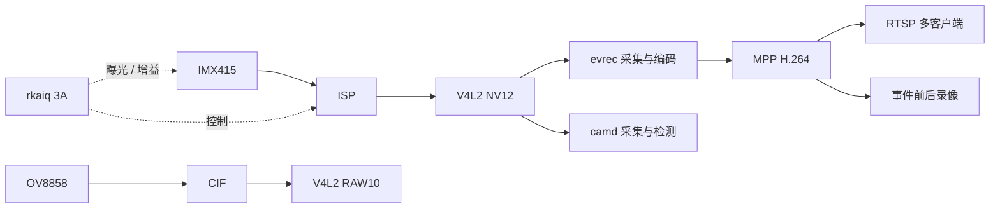

# RK3568 双摄采集与流媒体

基于 RK3568 和 Linux 4.19 厂商 BSP 的相机实践项目：接入 IMX415 与 OV8858，探索 V4L2 采集、传感器驱动、H.264 事件录像和 RTSP 推流，并保留调试过程中的失败与验证记录。

项目重点是**嵌入式 Linux 中相机数据怎么从驱动走到应用，以及出现问题时如何分层定位**。

## 系统结构

`evrec` 与 `camd` 是不同程序，图中表示各自的数据路径，不表示它们可以同时独占同一采集节点。OV8858 经 CIF 输出 RAW10；IMX415 经 ISP 输出 NV12。

## 主要实现与问题

- **相机驱动与采集：** OV8858 V4L2 subdev 驱动包含 I²C 寄存器访问、上电时序、格式和开关流等路径。调试时曾因实际物理口与假设的 I²C 总线不一致而走弯路；核对接线和设备拓扑后再定位问题。[驱动源码](driver/ov8858_sm/ov8858_sm.c) · [I²C 排障记录](docs/09-L1A-I2C调试复盘-物理口与总线映射.md) · [寄存器与厂商驱动对照](docs/17-L1-B对照报告-自写驱动vs厂商.md)
- **事件录像与流媒体：** `evrec` 将编码数据写入有界环形缓冲，按事件保存前后片段；`rtsp_hub` 为客户端维护独立游标，并处理慢客户端。[事件录像](tools/evrec.c) · [RTSP 实现](tools/rtsp_hub.c) · [录像设计与验证](docs/32-事件录像.md)
- **线程与缓冲区：** `camd` 使用有界队列将采集帧交给消费者，并通过引用计数管理 V4L2 buffer 的归还。采集、检测和事件处理的容量与失败恢复是独立问题。[采集与队列源码](tools/camd.c) · [可靠性记录](docs/29-可靠性工程.md)
- **内核问题定位：** 项目记录了格式协商、运行时电源管理及异常路径问题；复盘区分源码分析、历史版本实测和未部署的后续修改。[内核问题记录](docs/28-内核问题闭环.md) · [启动故障复盘](docs/36-硬件事故与恢复手册.md)

## 构建与复现

`evrec` 和 `camd` 依赖 Rockchip MPP、RGA、RKNN 头文件与运行库；在依赖齐全的目标环境中可参考顶层 [Makefile](Makefile) 的 `make apps`。具体设备节点、模型和服务版本以现场检查为准，历史板端命令见[环境与复现说明](docs/35-验收环境与复现命令.md)。

不接板时，可在 Linux 主机运行 `python3 tools/tests/test_evrec_preload.py` 检查事件收尾的文件错误路径；这是主机替身测试，不能当作真实相机或设备路径已验证。

## 验证与边界

项目采用 AI 辅助开发，AI 参与了代码、排障和文档工作。我参与了相机接线、板端操作、datasheet 查阅和部分驱动修改；启动 panic 的根因定位得到 AI 协助。应用侧仍在学习，实验的环境与验证范围见相应记录。

- 历史 RTSP 测试记录包含双客户端并发、慢客户端隔离和事件录像并存场景；测试对应当时的程序版本和环境，不能自动视为当前版本的复测结果。[2026-10-29 板测记录](evidence/2026-10-29-H5板测/README.md)
- 驱动近期修改有 VM 对象编译记录；没有找到对应当前源码的部署与板测证据。历史出图和回归结果对应当时的内核版本。[编译记录](evidence/2026-11-05-无板夹具与编译/README.md) · [历史验收记录](docs/34-最终验收报告.md)
- 零拷贝是单独的实验链路。`camd --npu-native` 只对输入使用 native 内存，输出仍经 `rknn_outputs_get`；输出 native 的字节对照出现过差异并已回退。[实验说明](zerocopy/README.md) · [输出对照](evidence/2026-10-25-质量保障线/fv_ab2.json)
- 没有完成 24 小时连续稳定性、四客户端满载长跑、功耗实测或 Android Camera HAL3 实操；OV8858 走 CIF RAW10，未做完整 ISP/IQ 调优。旧版延迟和部分性能数字的逐次附件未完整入库，不能当作当前版本的独立复测结果。
- 板上 3A 与采集有生命周期约束；运行中的服务和现役环境需要先核实，不能把历史命令直接套用到当前状态。[复现与环境说明](docs/35-验收环境与复现命令.md)

## 继续阅读

[文档入口](docs/README.md)按驱动、流媒体、故障与验证组织；[历史版本首页](https://github.com/Ericsunny/rk3568-camera-driver/blob/b2755646941c2cc3aa1fab1aa3f4d1fa273fa42c/README.md)保留原有结果与实验上下文。旧实验图片仍在 `evidence/` 中：例如[双路预览](evidence/2026-10-21-L3-双路预览.png)主要记录当时两路出图，画面和色彩不用于代表当前画质。
