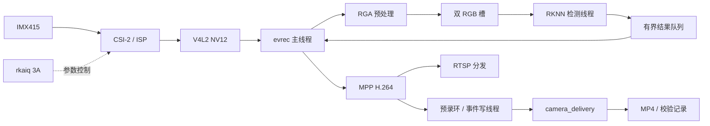

# RK3568 相机驱动与事件视频服务

面向固定机位的室内入口留证：采集 IMX415 图像，检测人员活动，保存触发前后的可解码录像，并提供局域网 RTSP 观看。重点是相机接入、缓冲所有权、检测与编码预算，以及异常情况下的文件交付。

当前主链为 **IMX415 → CSI-2 / ISP → V4L2 NV12 → RGA / RKNN 检测与 MPP 编码 → 事件录像和 RTSP**。基于 Rockchip Linux 4.19 BSP，图像控制依赖 rkaiq，模型使用既有预训练模型。

[架构与数据链路](docs/overview/architecture.md) · [运行与配置](docs/overview/final-system.md) · [性能与验证](docs/improvement/project-review.md) · [文档索引](docs/README.md)

## 主服务结构



检测线程仅在 `DETECT_PIPELINE=1` 时启用，默认保留串行作为兼容与对照路径。采集、RGA和编码仍由主线程组织，并行发生在RGA输出独立RGB缓冲之后。

## 关键实现

- **输入共享与归还：** MPP分配的DMA-BUF由V4L2导入，采集与编码复用NV12；匹配编码器归还的task/frame/PTS/buffer后才QBUF，避免覆盖仍在使用的输入。copy路径保留。
- **检测流水线：** 两个RGB槽、一个检测线程和八项结果队列。只替换尚未运行的任务，RKNN context由worker独占。结果带帧序号、epoch和来源时刻，拒绝过期与旧会话结果。
- **事件留证：** 缓存H.264包，从IDR开始保存前后片段，通过有界队列异步写入；独立交付进程封装MP4，核对索引、文件、帧数和哈希，失败不发布为完整交付。
- **慢端隔离：** 一次编码供录像和RTSP复用，客户端独立游标与副本，锁内复制、锁外发送，发送超时断开慢端。
- **可选观测：** 最多4096条内存记录，退出输出CSV/meta，记录驱动序号、DQ、编码输出、输入归还和QBUF；默认关闭。

## 已有结果

2026-11-17的IMX415单路、1080p、标称15fps有限测试，条件和版本见[结果说明](docs/improvement/project-review.md)，数据见[公开测量记录](evidence/2026-11-17-single-camera-release/README.md)。

| 对照 | 结果 | 条件与代价 |
|---|---|---|
| copy → 编码共享输入 | recorder CPU时间/完成帧5.8351→4.9084ms，下降约15.9% | 检测、观测关闭；两者均约15fps；共享模式持有采集buffer更久 |
| 串行 → 检测流水线 | 13.1786→15.0003fps；并行两轮驱动序号缺口0，573/574个结果全部有效 | 保留逐帧检测；额外约1.17MiB RGB；CPU成本/帧约增加3.4% |
| 流水线人员场景 | 1638帧与有效检测，DQ→应用P95为88.521ms，三份事件解码核对通过 | 有一次计划外再入镜；不是准确率或精确物理响应测试 |

两项CPU百分比来自不同负载，不能相减。软件结果年龄不是显示延迟；约300ms光学基线来自旧版manual，无流水线前后显示对照。

## 运行

目标Linux需提供MPP、RGA、RKNN头文件和运行库、C++17编译器、media-ctl与FFmpeg/FFprobe。模型路径、哈希、设备及3A服务须匹配实际环境。

```sh
make apps
# 使用新的绝对运行目录
./camera_demo imx415-isp manual /root/event-manual-run
# 预热后在另一终端：touch /root/event-manual-run/trigger
DETECT_PIPELINE=1 ./camera_demo imx415-isp detect /root/event-pipeline-run
```

标准入口默认编码与检测输入共享、每帧检测；裸evrec输入默认值不同。详见[运行说明](docs/overview/final-system.md)。源码合入不代表板端内核或现役程序已替换。

## 驱动与其他路径

仓库保留OV8858 V4L2 subdev驱动及BSP接入，覆盖I²C、上电、格式、开关流和runtime PM；两个独立实例的历史双路联测另有记录。**当前吞吐与人员结论只覆盖IMX415单路**。OV8858参考IQ、历史CSI CRC问题及双路限制见[源码验证范围](docs/acceptance/source-status.md)。

camd、mini3a、zerocopy为独立工具或实验，不与主服务功能、零拷贝或验证结果混用。[OV8858接入](docs/bringup/ov8858-isp-integration.md) · [内核故障复盘](docs/runbook/boot-recovery.md) · [历史双路](docs/pipeline/dual-camera.md)

## 已知限制

未完成统计识别准确率、精确入镜响应、流水线显示延迟、长期运行或流水线双路/恢复组合验证。RTSP仍有回环地址字段兼容性问题；事件文件和监督器seen集合随运行累积，没有保留期清理。队列有界不等于无限期全局资源有界。
