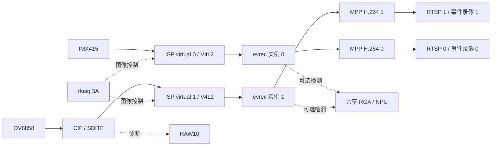

# RK3568 相机驱动与事件视频服务

基于 RK3568 和 Linux 4.19 厂商 BSP 的双摄事件视频系统：接入两种不同的图像传感器，通过 V4L2 采集并提供编码、录像和 RTSP 观看能力。

服务可选择 IMX415 或自写驱动的 OV8858，也可启动两个独立实例并发采集和输出；两路检测触发、录像与 RTSP 已做有限联测，事件收尾的场景边界见记录。OV8858 使用参考 IQ。项目重点是**相机数据从驱动到应用的实现，以及问题的分层定位**。[系统设计与运行基线](docs/overview/final-system.md) · [双路联测](evidence/2026-11-11-dual-followup/event02-natural-close.md)

[文档索引](docs/README.md) · [系统架构](docs/overview/architecture.md) · [启动故障与恢复](docs/runbook/boot-recovery.md) · [测试与验证范围](docs/acceptance/summary.md)

## 系统结构



两路可面向不同区域，各自输出和保存事件；这是开发板上的验证场景。双路模式使用两个独立的 `evrec` 进程，各自有编码器、录像目录和 RTSP 端口。两路共享物理 ISP 和 NPU，并发采集不等于同步双目；双路检测、录像和推流的组合已作有限联测。`camd` 是独立采集程序，不能同时占用同一采集节点。

`mini3a` 是独立的 AE 诊断与 AWB 参数实验，和 `rkaiq` 不应同时控制该链路；本轮验证了 AE，AWB 图像效果另行说明。OV8858 RAW10 可用于原始保存及离线分析。[控制实验入口](mini3a/README.md) · [两路格式与处理](docs/pipeline/dual-camera.md)

## 主要实现与问题

- **相机驱动与采集：** OV8858 V4L2 subdev 驱动包含 I²C 寄存器访问、上电时序、格式和开关流等路径。调试时曾因实际物理口与假设的 I²C 总线不一致而走弯路；核对接线和设备拓扑后再定位问题。[驱动源码](driver/ov8858_sm/ov8858_sm.c) · [I²C 排障记录](docs/bringup/i2c-debug.md) · [寄存器与厂商驱动对照](docs/bringup/driver-comparison.md)
- **事件录像与流媒体：** `evrec` 缓存编码包、按事件保存前后片段；独立进程自动封装 MP4，校验帧数并记录失败。`rtsp_hub` 为客户端维护独立游标，处理慢客户端。[录像与交付](docs/pipeline/event-recording.md) · [RTSP 实现](tools/rtsp_hub.c) · [当前运行结果](evidence/2026-11-08-event-service/README.md)
- **历史录像示例（2026-11-06）：** [观看 MP4](evidence/2026-11-06-event-demo/event.mp4) · [原始记录](evidence/2026-11-06-event-demo/README.md)。该示例为当时程序手动触发；当前版本验证见事件服务基线。
- **线程与缓冲区：** `camd` 使用有界队列将采集帧交给消费者，并通过引用计数管理 V4L2 buffer 的归还。采集、检测和事件处理的容量与失败恢复是独立问题。[采集与队列源码](tools/camd.c) · [可靠性记录](docs/stability/reliability.md)
- **内核问题定位：** 基于启动日志与调用链，定位并修复了传感器格式协商触发的内核空指针异常；记录还覆盖运行时电源管理和错误路径。[启动 panic 复盘](docs/runbook/boot-recovery.md) · [内核问题记录](docs/stability/kernel-issues.md)

## 快速开始

`evrec` 和 `camd` 依赖 Rockchip MPP、RGA、RKNN 头文件与运行库；自动交付另需 Python 3、FFmpeg/FFprobe。在依赖齐全的目标 Linux 环境中可运行：

```bash
make apps
sh tools/run_camera_demo.sh ov8858-isp manual /root/new-event-run
# 预热后，在另一终端 touch /root/new-event-run/trigger
# IMX415 配置改为 imx415-isp；人体检测模式将 manual 改为 detect
# 双路手动模式：两个独立目录，端口分别为 8554 和 8555
python3 tools/run_dual_camera.py manual /root/new-dual-run
# 分别触发 /root/new-dual-run/imx415/trigger、/root/new-dual-run/ov8858/trigger
```

构建选项见 [Makefile](Makefile)。OV8858 驱动在历史 BSP 中内建，不能套用通用的 `insmod` 示例；源码编译、部署和板测是不同步骤。设备节点、模型、工具链和服务版本以现场检查为准，历史命令见[环境与复现说明](docs/acceptance/reproduction.md)。

不接板时，可在 Linux 主机运行 `python3 tools/tests/test_evrec_preload.py` 检查事件收尾的文件错误路径；这是主机替身测试，不能当作真实相机或设备路径已验证。

一次 IMX415 现场采集的[原始输出转换图](evidence/2026-11-06-imx415预览/frame12.png)及[采集条件](evidence/2026-11-06-imx415预览/README.md)可供查看；照片是当前场景的单帧展示，不是画质对比。

## 验证与边界

- 历史 RTSP 测试记录包含双客户端并发、慢客户端隔离和事件录像并存场景；测试对应当时的程序版本和环境，不能自动视为当前版本的复测结果。[2026-10-29 板测记录](evidence/2026-10-29-H5板测/README.md)
- 默认启动为 #62；OV8858 ISP 接入及独立应用目录的验证范围与指纹见[接入记录](evidence/2026-11-10-camera-integration/README.md)和[后续修复](evidence/2026-11-10-imx415-drc-review/README.md)。OV8858 的参考 IQ 已启用 DRC，[参数与单场景对照](docs/image/drc-validation.md)有响应；这不代表本模组已完成 IQ 标定。
- #62 下，两路检测事件期间两个回环 RTSP 客户端持续解码，两路 MP4 均能独立解码，程序均以 `target_left` 收尾；一次抽帧中 IMX415 画面边缘仍有人体，不能将该状态等同于整幅画面无人。[联测与边界](evidence/2026-11-11-dual-followup/event02-natural-close.md) · [前次联测](evidence/2026-11-11-dual-followup/event-concurrent-report.md)
- `evrec` 默认使用复制输入；MPP 共享采集缓冲是可选实验路径，能减少采集到编码之间的一次整帧 CPU 复制，OV8858 恢复测试中出现的 CRC 尚待排查。[共享输入对照及验证范围](evidence/2026-11-14-dmabuf-allocation/README.md)。`camd --npu-native` 是另一条实验路径，只对输入使用 native 内存，输出仍经 `rknn_outputs_get`；输出 native 的字节对照出现过差异并已回退。[实验说明](zerocopy/README.md) · [输出对照](evidence/2026-10-25-质量保障线/fv_ab2.json)
- OV8858 可选择 CIF RAW10 诊断，候选路径也可通过 ISP 取得 NV12；部分历史性能数据的原始附件未完整入库，适用范围见对应记录。
- 板上 3A 与采集有生命周期约束；运行中的服务和现役环境需要先核实，不能把历史命令直接套用到当前状态。[复现与环境说明](docs/acceptance/reproduction.md)

## 继续阅读

[文档入口](docs/README.md)按驱动、流媒体、故障与验证组织；[历史版本首页](https://github.com/Ericsunny/rk3568-camera-driver/blob/b2755646941c2cc3aa1fab1aa3f4d1fa273fa42c/README.md)保留原有结果与实验上下文。旧实验图片仍在 `evidence/` 中：例如[双路预览](evidence/2026-10-21-L3-双路预览.png)主要记录当时两路出图，画面和色彩不用于代表当前画质。
