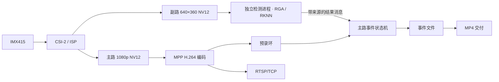

# RK3568 室内入口事件录像与实时预览

单颗 IMX415 同时服务于入口巡看与人员留证。主路持续编码 1080p 视频，副路逐帧检测人员。主路在人员连续命中时保存可解码的前情片段，并通过 RTSP/TCP 提供局域网预览。



## 在目标板上运行

已验证环境为 RK3568、IMX415、Rockchip Linux 4.19.232 #62，板上已有匹配的 rkaiq、MPP、RGA、RKNN 与模型。先核对[依赖、模型指纹与停止方法](docs/overview/final-system.md)。在仓库根目录执行：

```sh
make -j2 entrance
./camera_demo imx415-isp entrance /var/tmp/entrance-run-001
```

使用一个尚不存在的绝对目录。默认 RTSP 端口为 8554，客户端通过 `rtsp://板卡地址:8554/live` 观看。事件交付状态见运行目录的 `*.delivery.json`。需要无人员配合验证文件链路时，使用[手动触发模式](docs/overview/final-system.md)。

## 核心实现与证据

| 工程问题 | 实现与验证 |
|---|---|
| 推理不应拖住高清留证 | 主路 V4L2 与 MPP 共享 NV12 输入，MPP 归还对应缓冲后再 QBUF。副路 RGA 转色、填边到 640×640 RGB，再由独立进程执行 YOLOv8n。 |
| 算完了，主路何时能用结果 | 同负载下，连续扫描使两进程合计 CPU 从 22.65 降至 15.09 ms/主路源帧。随后联合监听使源帧至主路接受结果的 P95 从 104.81 降至 76.32 ms。人员对照未证实开录同步提前。 |
| 副路重开，旧阳性可能误触发 | 检查进程代次、源帧与时间戳。已有板端注错轮主路完成 363/363 帧，57 条构造的旧阳性均被拒绝，新鲜结果仍能触发。 |
| 录像与观看竞争同一编码输出 | 事件文件从 IDR 起写，监督器调度封装和校验。RTSP 客户端独立维护发送进度；磁盘错误和慢连接分别处理。 |
| 录像盘接近写满时怎样保留新证据 | 可选 C++ 回收进程按容量和文件系统余量处理已交付的旧片段，支持保留标记与重启续清。[启动方法与板端验证](docs/improvement/recording-retention.md) |

[架构、所有权与恢复](docs/overview/architecture.md) · [发布验证与测量口径](evidence/2026-11-20-entrance-release/README.md) · [文档索引](docs/README.md)

同板短测和故障注入均有记录。新 BSP、不同局域网客户端、长时间无人值守和磁盘保留策略需按部署条件验证。仓库中的其他传感器驱动、早期双缓冲程序与原生模型输入实验各有独立的[源码范围](docs/acceptance/source-status.md)。
