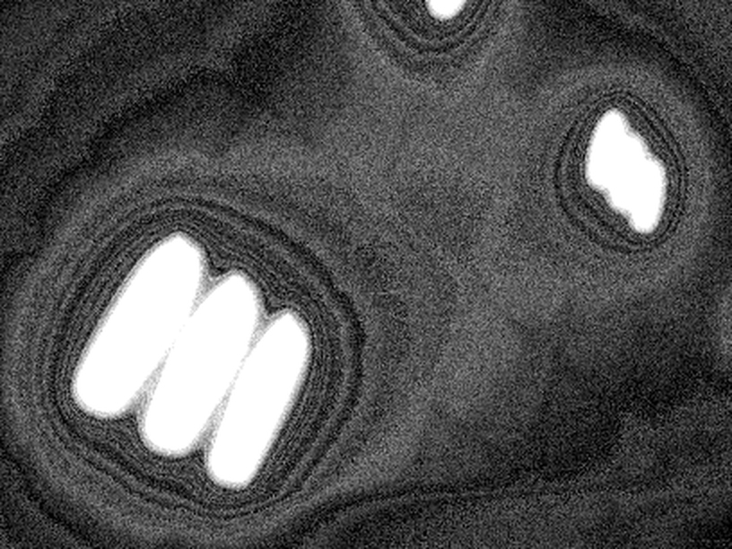

# RK3568 MIPI 相机子系统 Bring-up

在 **YCKJ-RK3568**(Rockchip RK3568,kernel 4.19.232)开发板上,从零完成 MIPI CSI-2 相机子系统的 bring-up:传感器点亮 → V4L2/media 管线 → 用户态 3A 闭环 → **按 datasheet 裸写 sensor 驱动** → V4L2 零拷贝(EXPBUF/dmabuf → RGA → NPU)→ **异构双摄(ISP + CIF 并行)**。

## 关键结果(先看这里)

| # | 结果 | 证据 |
|---|------|------|
| 1 | IMX415 从设备树使能到第一帧全链打通(3840×2160 NV12) | 双帧 md5 不同(活水验证):`ec801915…` / `aa25a360…`,均 12,441,600 B |
| 2 | 手写用户态 3A 闭环,AE/AWB 双收敛 | Y: 1 → 101,U/V → 128/128;约 250 行 C,见 [`mini3a/`](mini3a/) |
| 3 | 定位并修复厂商 BSP 内核缺陷(params 通路结构体尺寸未随 ISP2.1 更新) | `isp_params.c` v21 分支补 `sizeof(struct isp21_isp_params_cfg)`:5813 → 10475 |
| 4 | 定位"点不亮"真因:物理接口假设错误(而非供电/时钟) | 三次误判修正链 + 物理口↔总线映射表:[`docs/09`](docs/09-L1A-I2C调试复盘-物理口与总线映射.md) |
| 5 | **按 datasheet 裸写 OV8858 V4L2 subdev 驱动并出图** | 驱动 821 行,双模式 **29.3 fps / 帧结构 100% 有效**;与厂商逐寄存器对照见 [`docs/17`](docs/17-L1-B对照报告-自写驱动vs厂商.md) |
| 6 | **V4L2 零拷贝:EXPBUF → dmabuf → RGA → NPU** | `memcpy` **13.67 MB/帧 → 0**;延迟 92.5 → **69.9 ms**;CPU **−66%**(38.3 → 13.0 ms/帧);三线程流水线在 2× 负载下 **+25%** 吞吐,见 [`zerocopy/`](zerocopy/) |
| 7 | **异构双摄同时开流(IMX415@ISP + OV8858@CIF)** | 两路帧率与单路**完全一致**(15.00 / 30.02 fps,零干扰),总写入 **249.8 MB/s**,CPU ≈6.6% 单核;见 [`docs/19`](docs/19-L3异构双摄报告.md) |
| 8 | **ISP 白平衡:把绿偏色修掉** | params 通路下发 `gain_r=0x1EC / gain_b=0x1F0`,色度从 `U−21.4/V−27.0` 收敛到 `U−1.4/V−0.9`;四条通路对比见 [`docs/21`](docs/21-L2-AWB.md) |
| 9 | **驱动补 pm_runtime,suspend/resume 链路恢复** | runtime PM 三态迁移实测通过(probe→suspended / 开流→active / 关流→2s→suspended);系统 suspend/resume 后抓帧正常、uptime 连续;见 [`docs/20`](docs/20-L4电源管理.md) |
| 10 | **修好 rkaiq 的 AWB:段错误根因是 IQ 缺 `smartRun`** | 2024 的 AIQ 6.0 库 + 2022 的 IQ → `AwbPreProcV201` 拿 `NULL/NULL/len=0` 插值必崩;补 13 行 JSON 后 **600 帧不崩**;见 [`tools/iq_patch_smartrun.py`](tools/iq_patch_smartrun.py)、[`docs/21`](docs/21-L2-AWB.md) |
| 11 | **同场景 A/B:mini3a 稳定,rkaiq 当时是坏的** | 配对两轮,mini3a 逐位可重复(Y≈113、U/V **128.0/128.0**),rkaiq 末态 Y = **181 / 51 / 75** 三轮漂 3.6 倍;根因是 IQ/库/BSP 版本不配套(每帧 `Can not get isp params buffer`),见 [`docs/21`](docs/21-L2-AWB.md) §8 |
| 12 | **补 `enum_frame_size` + `compat_ioctl32`,并揪出 PAN oops 真 bug** | 内建驱动(`=y`)必须重编 Image 刷 `/boot` 才生效;`enum` 实测 1632×1224 / 1920×1080;`compat_ioctl32` 一加就让 32 位路径把内核打崩——驱动对**用户指针**直接 `memset`,32 位没走 `video_usercopy` → 改成 `kzalloc + copy_to_user`;**32/64 位均 OK**;见 [`docs/17`](docs/17-L1-B对照报告-自写驱动vs厂商.md) §10 |
| 13 | **修好 rkaiq 3A:换回配套的 2022 三件套** | 厂商只把 `librkaiq.so`/`rkaiq_3A_server` 升到 2024 版、IQ 还是 2022 的 → 用 SDK 里 2022-04 的 deb(板上有 `.bak-2022`,md5 逐字节相同)整套换回:**AE 60 帧收敛到 Y≈110、AWB 稳定、`params buffer` 报错 114~289 → 0**;重测 A/B:rkaiq **15 ms/帧** vs mini3a 36.3 ms/帧,见 [`docs/21`](docs/21-L2-AWB.md) §9 |



- **传感器**:Sony IMX415(4K Starvis,2-lane MIPI,野火模组 EBF410358)+ OmniVision OV8858(8MP,2-lane,R2A)
- **转接**:野火"树莓派摄像头转鲁班猫"转接板(模组 24P → 板卡 15P FPC)
- **构建**:SDK 内核源码在 VM(Ubuntu 20.04)交叉编译,工具链为 SDK 自带 buildroot 9.3.0;内核/设备树经 boot 分区 + `boot.scr` 部署到板

## 硬件链路

```
IMX415 模组(24P 0.5mm) → 野火转接板 → 15P 1.0mm FPC → 板卡 J10(CAM0, I2C1)
                                              ↓
              csi2-dphy1(split mode, lane0/1) → RKCSI → RKISP → /dev/video0 (mainpath, NV12)

OV8858 模组(24P)      → 野火转接板 → 15P 1.0mm FPC → 板卡 J11(CAM1, I2C5)
                                              ↓
              csi2-dphy2(lane0/1) → rockchip-mipi-csi2 → rkcif → /dev/video0 (stream_cif_mipi_id0, RAW10)
```

两个 15P 座引脚序完全相同,唯一差异是背后的 I2C 控制器与 D-PHY 实例——**物理口与总线号必须先核对再调试**(血的教训,见 [`docs/09`](docs/09-L1A-I2C调试复盘-物理口与总线映射.md))。

## 里程碑

| 阶段 | 内容 | 状态 |
|------|------|------|
| L1-A P1 | 设备树使能 i2c1 + `imx415@1a`,dtb 编译部署 | ✅ |
| L1-A P2 | sensor probe(`Detected imx415 id 0000e0`)+ media 管线端到端挂载 | ✅ 2026-10-07 |
| L1-A P3 | mainpath 第一帧 NV12 + RAW10 对照(双 md5 活水验证) | ✅ 2026-10-08 |
| L2-lite | rkaiq 深水区留档 → 改为手写用户态 3A 闭环(`mini3a/`),AE/AWB 双收敛 | ✅ 2026-10-12 |
| **L1-B** | **按 OV8858 datasheet 裸写 V4L2 subdev 驱动**:自推时序 + 借用模拟块,完成后与厂商逐寄存器对照 | ✅ 2026-10-21 |
| **零拷贝** | VB2 EXPBUF 导出 dmabuf fd → RGA 零拷贝缩放 → NPU 消费;三模式 perf 对比 + 多路 + 流水线 | ✅ 2026-10-21 |
| L2.5 | 相机 → NPU 实时检测 | ✅ 已并入零拷贝链路(`zerocopy/zc_npu`) |
| **L3** | 异构双摄(dphy1@ISP + dphy2@CIF 并行)+ 带宽/负载测量 + 两种格式的消费者设计 | ✅ 2026-10-21 |
| **L4** | 给 ov8858_sm 补 `pm_runtime`:三态迁移实测 + 系统 suspend/resume 链路 | ✅ 2026-10-21 |
| **L2-AWB** | ISP 白平衡四条通路 + rkaiq 段错误根因(2022 IQ 缺 `smartRun`)+ 修复 | ✅ 2026-10-21 |
| **收尾** | 补 `enum_frame_size` / `compat_ioctl32`;顺带修掉 32 位路径的 PAN oops;与 mini3a 做同场景 A/B | ✅ 2026-10-21 |
| **L2-AWB 收尾** | rkaiq 3A 真正跑通:换回与 4.19 BSP 配套的 2022 三件套(库+server+IQ 同源),重测 A/B | ✅ 2026-10-22 |

## 仓库结构

```
driver/ov8858_sm/   从 datasheet 裸写的 OV8858 sensor 驱动(.c/.h/Makefile + 说明)
zerocopy/           V4L2 零拷贝链路:EXPBUF→dmabuf→RGA→NPU,三模式 perf 对比 + 多路 + 流水线
mini3a/             用户态 3A 闭环(V4L2 MPLANE 采集线程 + AE/AWB 控制环)
docs/               任务书、排障复盘、对照报告、陪跑手册
evidence/           实测证据(第一帧 / 厂商对照 / 1080p / anchor 修复前后 / 双路预览 / rkaiq 修复)
tools/              IQ 补丁脚本 / 32-64 位 compat 对照 / 换驱动流程 / 同场景 A/B 脚本(tools/ab/)
```

## 文档

- [docs/08-模块四任务书-五件套骨架驱动](docs/08-模块四任务书-五件套骨架驱动.md) —— 内核模块构建配方 + 五件套(regulator/clk/runtime PM/ctrl/endpoint)任务书。
- [docs/09-L1A-I2C调试复盘](docs/09-L1A-I2C调试复盘-物理口与总线映射.md) —— "现象全指向硬件供电、真凶是物理接口假设"的完整排障实录:三次误判修正链、物理口↔总线映射表、bring-up 七条纪律。
- [docs/10-L1A-Phase3-第一帧任务书](docs/10-L1A-Phase3-第一帧任务书.md) —— V4L2 用户态抓帧实操(NV12/RAW10 双路径 + 预测题 + 验收标准)。
- [docs/11-L2.5-管线整合排期与留痕](docs/11-L2.5-管线整合排期与留痕.md) —— 管线整合排期 + 工作留痕登记簿(每条含"面试复述要点")。
- [docs/12-L2lite-rkaiq点亮任务书](docs/12-L2lite-rkaiq点亮任务书.md) —— rkaiq 点亮任务书(目标/资料/手术点/预测题格式)。
- [docs/16-模块四动手手册](docs/16-模块四动手手册-一步一步版.md) —— 从 hello-module 到出图的逐步手册,§5.9~§5.14 是 L1-B 与 1080p 的完整记录。
- [docs/17-L1-B对照报告](docs/17-L1-B对照报告-自写驱动vs厂商.md) —— **交付级报告**:与厂商逐寄存器对照、哪些是自推的、实测数据、诚实清单;§10 是补 `enum_frame_size`/`compat_ioctl32` 的收尾记录(含内建驱动刷机流程和 PAN oops 真因)。
- [docs/18-阶段二零拷贝任务书](docs/18-阶段二零拷贝任务书.md) —— EXPBUF/dmabuf/RGA/NPU 全链路、perf 指标定义、S1~S5 验收、多路与流水线数据。
- [docs/19-L3异构双摄报告](docs/19-L3异构双摄报告.md) —— 两路同时开流实测、带宽/负载表、NV12 与 RAW10 两套消费者设计,以及"单 ISP 决定了异构是唯一解"的分析。
- [docs/21-L2-AWB](docs/21-L2-AWB.md) —— ISP 白平衡:四条通路(rkaiq / mini3a / 寄存器直写 / params)实测对比,以及从 U/V 偏差反推增益的方法;§6 是 **rkaiq AWB 段错误的根因(2022 IQ 缺 `smartRun`)与修复**,§8 是 **rkaiq vs mini3a 的同场景配对 A/B**,§9 是 **把 rkaiq 换回与 BSP 配套的 2022 三件套后真正跑通**的根因与复测数据。
- [tools/iq_patch_smartrun.py](tools/iq_patch_smartrun.py) —— 给旧 IQ 补 `wb_v21.autoExtPara.smartRun.cfg` 的脚本(幂等、文本插入、插入后校验),配 [tools/README](tools/README.md)。
- [docs/20-L4电源管理](docs/20-L4电源管理.md) —— 给 ov8858_sm 补 pm_runtime 的 4 处改动、runtime PM 三态验证、系统 suspend/resume 链路恢复,以及"带流 suspend 会挂死"的已知限制。

## 环境

- 板卡串口 1500000 8N1(CH340);SSH 静态 IP;内核/设备树在 VM 交叉编译后部署到板(boot 分区 + `boot.scr`)
- 调试三件套:`media-ctl -p`(管线拓扑)/ `v4l2-ctl`(格式与抓流)/ `dmesg`(probe 与运行时日志)
- 外部内核模块构建要点:工具链 PATH **追加**(其自带 python2 已损坏)、`LD_LIBRARY_PATH` 指向工具链 `lib/`(否则 cc1 报 `libisl.so.15`)、`modinfo | grep vermagic` 必须等于 `4.19.232 SMP mod_unload aarch64`
- ⚠️ 本 BSP 里 `CONFIG_VIDEO_OV8858_SM=y`(**内建**,`/proc/modules` 为空),改这个驱动必须**重编 `Image` 刷 `/boot`**,`insmod`/`depmod` 一律无效;流程见 [tools/README](tools/README.md)

## 许可

代码部分 [GPL-2.0](LICENSE)(与 Linux 内核一致,便于将来向上游提交);`docs/` 下的文档采用 CC BY 4.0。
