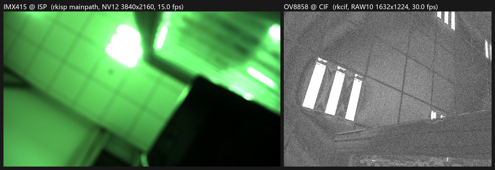

# RK3568 MIPI 相机子系统 Bring-up

在 **YCKJ-RK3568**(Rockchip RK3568,kernel 4.19.232)开发板上,从零完成 MIPI CSI-2 相机子系统的 bring-up 与产品化:传感器点亮 → V4L2/media 管线 → 3A → **按 datasheet 裸写 sensor 驱动** → 零拷贝(EXPBUF/dmabuf → RGA → NPU)→ **异构双摄(ISP + CIF)** → 检测/RTSP 推流/事件录像与可靠性工程。



---

## 一页纸看懂这个项目

**做了什么**:两个传感器(IMX415 / OV8858)从点不亮,做到能同时出流、能检出人、能推流、能自动录像;整个过程中的内核缺陷、性能数字与能力边界全部实测记录(118 commits,失败记录与成功记录一样多)。

### 六个数字

| 数字 | 含义 | 位置 |
|---|---|---|
| **0 B/帧** | 零拷贝后每帧 memcpy 从 13.67 MB 降到 0(**历史 zerocopy/ 实验;当前 evrec 仍为拷贝路径**,见下方边界) | §核心成果 2 |
| **−66%** | 同链路 CPU 从 38.3 → 13.0 ms/帧 | §核心成果 2 |
| **0/300** | 开关流压测失败数(首帧 445±12 ms) | [`docs/27`](docs/27-稳定性回归.md) |
| **30.04 fps** | 1800 帧长跑,零丢帧、零 buffer 泄漏 | [`docs/27`](docs/27-稳定性回归.md) |
| **18.9 ms** | RTSP 服务端到客户端延迟(p95 19.9) | [`docs/31`](docs/31-M8-RTSP推流.md) |
| **0 差异** | 自写驱动与厂商驱动逐寄存器对照(311+30 条) | [`docs/17`](docs/17-L1-B对照报告-自写驱动vs厂商.md) |

### 核心成果(六条)

**1. 按 datasheet 裸写 OV8858 V4L2 subdev 驱动并出图**
1158 行 C:上电时序/PLL/link_freq/曝光增益 ctrl/runtime PM 全部自推;与厂商驱动**逐寄存器对照零差异**;双模式 30.0 fps、帧结构 100% 有效;自推 1080p30 并定位修复 BLC anchor 越界致帧结构缺陷(179 空行→0,30 帧零错行)。→ [`driver/ov8858_sm/`](driver/ov8858_sm/) / [`docs/17`](docs/17-L1-B对照报告-自写驱动vs厂商.md)

**2. V4L2 零拷贝:EXPBUF → dmabuf → RGA → NPU**
每帧 CPU 拷贝 13.67 MB → **0 B**;端到端 92.5 → **69.9 ms**;CPU **−66%**;三线程流水线在 2× 负载下 **+25%** 吞吐。三模式(A 拷贝基线 / B RGA / C 全零拷贝)定量对照,收益拆解到环节。→ [`zerocopy/`](zerocopy/) / [`docs/18`](docs/18-阶段二零拷贝任务书.md)

**3. 异构双摄同时开流(IMX415@ISP + OV8858@CIF),零干扰**
两路帧率与单路完全一致(15.00 / 30.02 fps),总写入 249.8 MB/s,CPU ≈6.6% 单核——单 ISP 决定了"ISP+CIF 异构"是 RK3568 上双摄的唯一解。→ [`docs/19`](docs/19-L3异构双摄报告.md)

**4. 定位并修复 4 个内核/驱动缺陷(有复现、有根因、有回归)**
- ISP params 结构体尺寸未随 ISP2.1 更新 → 3A 全链死锁(`5813 → 10475`);
- `TRY_FMT` 写穿 `cur_mode` → 一次探测就换掉实际采集模式(实测落盘字节 2506752→2211840 才抓到);
- 停流错误被吞(`stop_streaming` 是 void)→ 补 `last_stop_err` 只读参数;
- 32 位 compat 路径用户指针裸 `memset` → 内核 **PAN oops**,改 `kzalloc+copy_to_user`。
→ [`docs/28`](docs/28-内核问题闭环.md) / [`docs/17`](docs/17-L1-B对照报告-自写驱动vs厂商.md) §10

**5. 3A 两层打通:修好厂商栈 + 自写用户态闭环**
修好 rkaiq(根因是 2024 库配 2022 IQ 的版本错配:AWB 段错误=IQ 缺 `smartRun`,3A 死锁=三件套不同源——整套换回配套 2022 后 `params buffer` 报错 289→0,AE 60 帧收敛);另写 `mini3a` 用户态闭环(AE 双自由度 + AWB 灰世界,Y 1→101 / UV→128/128)与之同场景 A/B。→ [`mini3a/`](mini3a/) / [`docs/21`](docs/21-L2-AWB.md)

**6. 产品化链路:检测触发事件录像 + RTSP 推流 + 可靠性**
`evrec`(环形缓冲 + 事件切片 + RTSP 服务端:慢客户端丢弃策略、非阻塞整包发送、有界恢复)与 `camd`(双消费者有界队列、buffer 引用计数归还、RGA 直接吃 DMA-BUF fd,4K→640 单帧 24.21→6.34 ms);工程化:systemd 托管 3A + md5 版本闸门 + 6 组一键自检。→ [`tools/`](tools/) / [`docs/29`](docs/29-可靠性工程.md) / [`docs/32`](docs/32-事件录像.md) / [`docs/24`](docs/24-M4-工程化.md)

### 三个"实现正确但场景不可用"的诚实结论

1. **检测**:解码/NPS 链路正确(`bus.jpg` 4 框全对、真人 1~3 m 12/12);但遮挡 >30% 即 0/12——写成安装约束,不用算法硬凑。
2. **零拷贝**:CPU 降到 1/3,但帧率没变——瓶颈在采集,收益在余量。
3. **suspend**:本板无 RTC、无远程唤醒源,**真实 suspend 退出无法验证**(`pm_test=devices` 模拟通过),不写成"通过"。

**当前工程边界(诚实清单)**:**3A 与采集共存**——rkaiq_3A 常驻时直接开流(AE/AWB 生效),干净停后无需重启,唯一红线是采流中不 stop/kill 3A(否则 STREAMOFF 超时 wedge,唯一恢复=重启),完整矩阵见 docs/29 §10、一键栈 `tools/run_3a_stack.sh`。**零拷贝三口径**——`zerocopy/` 实验链路输入+输出全 native(首屏"0 B/帧"指它);`camd --npu-native` 仅输入 native(RGA 直写输入 dmabuf+mem_sync;ab 108 帧字节级一致,证据 `evidence/2026-10-25-质量保障线/fv_ab_input_only.json`),**输出仍经 `rknn_outputs_get` 拷回**(输出 native 已试过:~5%/帧字节差、FROM_DEVICE sync 无效,疑 runtime requant——字节级验收不过,回退,证据同目录);`evrec` 检测路径当前为全拷贝。RTSP **只支持单客户端**(第二连接被拒绝,见 `cam_rtsp.c` 头注);稳定性证据:12 分钟事件录像 / 300 次开关流 / 1800 帧长跑 / **2h 服务级 soak(80 事件,RSS 21.7~43.6MB 有界、fd 恒 14、40.6~46.1°C,见 evidence/)**,仍**没有 24 小时连续、没有真实播放器 >10 分钟、没有掉电与 SD 卡写满场景**;**带流 suspend 已加双层保护**(驱动 streaming 时返回 `-EBUSY` 拒绝挂起 + `tools/suspend_guard.sh` 应用层护栏),但**不宣称 suspend 已修复**——真实唤醒仍无验证手段(`pm_test=devices` 干跑通过);OV8858 走 CIF RAW10 链路,**没有也不做 ISP 3A**(RK3568 单 ISP 给了 IMX415;OV8858 只有 mini3a 软件闭环,非产品级 IQ),bring-up 自测手段是 sensor 内部 test pattern ctrl(寄存器依据厂商驱动+datasheet 对照,非猜测)。

> 一句口径:**每个数字都有对应的测量方法([docs/31 对照表](docs/31-程序与证据对照表.md));没有测过的,不写在结果里。**

### 故障 → 根因 → 修复 → 验证(2026-10-27)

一段曾被误判为"板级硬件间歇故障"的 3 天事故,最终定位为**我们自己引入的过度防御**。完整复盘见 [docs/36](docs/36-硬件事故与恢复手册.md)。

| 环节 | 证据 |
|---|---|
| 现象 | 摄像头在位时开机 1.9 s panic,**3/3 确定性复现**;拔掉摄像头则干净引导 |
| 崩溃点 | `rkcif_set_fmt+0x2cc` NULL 解引用 → `Kernel panic - Attempted to kill init` |
| 调用约定 | 本 BSP 的 rkcif 把**流编号当 pad** 传入(`get_input_fmt(..., stream->id, ...)`,video0~3 → pad 0~3) |
| 触发条件 | #49/#51 的 `ov8858_sm` 对 **ACTIVE** 路径也做 `pad != 0 → -EINVAL`,流 1/2/3 全被拒 → `get_input_fmt()` 返回 NULL → 厂商代码不查空 |
| 为什么以前没暴露 | video0 = pad 0 被放行,历史测试全部只用 video0 |
| 修复 | #52(`04672f71`):ACTIVE 不再拒 pad(对齐同 SDK `imx415` 约定),**TRY 路径 `!cfg || pad != 0` 防御原样保留**;`enum_*` 未动 |
| 验证 | 无摄像头冷启动 PASS;**带摄像头冷启动 14/14 PASS**(`Detected OV8858`、无 `sensor fmt invalid`、无 `rkcif_set_fmt`、到 `login:`、media 12 条链路 ENABLED);`media-ctl -p` ×3 零 Oops |

证据目录:[`evidence/2026-10-27-上电调试/`](evidence/2026-10-27-上电调试/)(panic 全栈、通过日志、media 拓扑、A0 只读基线)。
**回退**:`/boot/Image-4.19.232` 的 #51 备份在板上 `/root/Image.p51`、主机 `rk_recovery/backup+stage`(均 `48b72b8d`),
出厂镜像备份 `/boot/Image-4.19.232.factory`(`ed86c707`)未动;dtb/extlinux 备份在 `/root/*.p51`。
**边界**:14 次冷启动只覆盖这一个故障模式,不代表板级硬件(供电/eMMC)已被全面排除;
`driver/patches/rkcif-null-check.patch` 是独立的厂商代码加固补丁,**不属于已验收的 #52 修复,本轮未部署**。

**两处旧认知修正**:①引导链**确实加载** `/boot/initrd-4.19.232`(日志 `Freeing initrd memory: 23996K`),
此前"extlinux 无 initrd 行即不加载"的推断作废;②`rk-kernel.dtb` 是**符号链接** → `dtb/rk3568-lubancat-2io.dtb`,
与 `rk356x-yckj.dtb` **内容相同**(均 `ba47c41c`),不是两份不同设备树。

### 从哪开始读

- 想复跑 → [`docs/33-总报告`](docs/33-总报告.md) §6(7 步顺序)或 [`docs/35-验收环境与复现命令`](docs/35-验收环境与复现命令.md)
- 想看驱动 → [`docs/17`](docs/17-L1-B对照报告-自写驱动vs厂商.md)(逐寄存器对照)
- 想看产品链路 → [`docs/32-事件录像`](docs/32-事件录像.md)
- 想看踩坑 → 各 docs 的"未完成/边界"节

---

<details>
<summary><b>全部结果明细(点开,19 项)</b></summary>

| # | 结果 | 证据 |
|---|------|------|
| 1 | IMX415 从设备树使能到第一帧全链打通(3840×2160 NV12) | 双帧 md5 不同(活水验证):`ec801915…` / `aa25a360…`,均 12,441,600 B |
| 2 | 手写用户态 3A 闭环,AE/AWB 双收敛 | Y: 1 → 101,U/V → 128/128;约 250 行 C,见 [`mini3a/`](mini3a/) |
| 3 | 修复厂商 BSP params 通路结构体尺寸缺陷 | `isp_params.c` v21 分支补 `sizeof(...)`:5813 → 10475 |
| 4 | "点不亮"真因:物理接口假设错误(非供电/时钟) | 三次误判修正链 + 物理口↔总线映射表:[`docs/09`](docs/09-L1A-I2C调试复盘-物理口与总线映射.md) |
| 5 | 裸写 OV8858 驱动出图 | 821 行,29.3 fps / 帧结构 100% 有效:[`docs/17`](docs/17-L1-B对照报告-自写驱动vs厂商.md) |
| 6 | 零拷贝三模式对比 | 0 B/帧、69.9 ms、−66% CPU、+25% 吞吐:[`zerocopy/`](zerocopy/) |
| 7 | 异构双摄零干扰 | 15.00 / 30.02 fps,249.8 MB/s:[`docs/19`](docs/19-L3异构双摄报告.md) |
| 8 | ISP 白平衡修正 | 色度 U−21.4/V−27.0 → U−1.4/V−0.9:[`docs/21`](docs/21-L2-AWB.md) |
| 9 | ov8858_sm 补 pm_runtime | runtime 三态实测;系统 suspend `pm_test` 模拟通过(真机无唤醒源,退出无法验证):[`docs/20`](docs/20-L4电源管理.md) |
| 10 | 修 rkaiq AWB 段错误(IQ 缺 `smartRun`) | 补 13 行 JSON 后 600 帧不崩:[`tools/iq_patch_smartrun.py`](tools/iq_patch_smartrun.py) |
| 11 | rkaiq vs mini3a 同场景 A/B | mini3a 逐位可重复;rkaiq 版本错配期三轮漂 3.6 倍:[`docs/21`](docs/21-L2-AWB.md) §8 |
| 12 | 补 `enum_frame_size` + `compat_ioctl32`,修 32 位 PAN oops | 用户指针裸 `memset` → `kzalloc + copy_to_user`,32/64 位均 OK:[`docs/17`](docs/17-L1-B对照报告-自写驱动vs厂商.md) §10 |
| 13 | rkaiq 3A 真正跑通(换回配套 2022 三件套) | 报错 289 → 0,AE 60 帧收敛;rkaiq 15 ms/帧 vs mini3a 36.3 ms/帧:[`docs/21`](docs/21-L2-AWB.md) §9 |
| 14 | 图像"糊"真因 = 镜头物理失焦,非 ISP 参数 | 手动对焦 `lap_var` 14.3→36.5(+155%);`snr mode:127` 是回退表非错误:[`docs/22`](docs/22-M1-图像质量.md) |
| 15 | 高光边界:DRC 在 2022 组合里不可用 | 传感器未饱和(可救 1.3 档);`OverExpCtrl` 让 clip 2.90→1.84%:[`docs/23`](docs/23-M3-高光与动态范围.md) |
| 16 | 开机即用:3A 自启 + 版本闸门 + 一键自检 | systemd 直接托管(厂商 forking+killall 根本停不掉);6 组断言全过:[`docs/24`](docs/24-M4-工程化.md) |
| 17 | 内核问题闭环:TRY_FMT 隔离 + 停流错误可定位 | 8 例 sweep `changed=0/8`;`last_stop_err`:[`docs/28`](docs/28-内核问题闭环.md) |
| 18 | 可靠性工程:双消费者有界队列 + buffer 引用计数 | 边界公式 `nbufs ≥ rt_depth+ev_depth+2`(-b 4 饿死 5.07 fps,-b 8 保持 30.22):[`docs/29`](docs/29-可靠性工程.md) |
| 19 | 稳定性回归:开关流/长稳/挂起自动化 | 300 次 0 失败、1800 帧零丢帧:[`docs/27`](docs/27-稳定性回归.md) |

</details>

<details>
<summary><b>里程碑时间线(点开)</b></summary>

| 阶段 | 内容 | 状态 |
|------|------|------|
| L1-A | IMX415 点亮:dtb→probe→第一帧(双 md5 活水) | ✅ 2026-10-08 |
| L2-lite | rkaiq 深水区 → 手写 mini3a 3A 闭环 | ✅ 2026-10-12 |
| L1-B | OV8858 裸写驱动 + 逐寄存器对照 | ✅ 2026-10-21 |
| 零拷贝 / L3 双摄 / L4 PM / L2-AWB | 同日四线收官 | ✅ 2026-10-21~22 |
| M1/M3/M4/M5 | 失焦定位 / 高光边界 / 工程化 / 内核闭环 | ✅ 2026-10-22 |
| M6+ | 稳定性回归、可靠性工程、evrec 事件录像+RTSP、产品化 | ✅ 2026-10-23~24 |
| HDR 预研 | 软件多帧融合落地(4K clip 5.74%→0%);2-lane DOL 带宽核算可行但 CSI 侧 overflow,定性为硬件边界 | 🔬 预研 |

</details>

## 仓库结构

```
Makefile            顶层板端构建(tools/apps/spy 分组,RGA/RKNN 能力自动探测)
driver/ov8858_sm/   从 datasheet 裸写的 OV8858 sensor 驱动(1158 行 .c + 455 行 .h + 自带 Makefile)
zerocopy/           V4L2 零拷贝链路:EXPBUF→dmabuf→RGA→NPU,三模式 perf 对比
mini3a/             用户态 3A 闭环(采集线程 + AE/AWB 控制环)
tools/              evrec(事件录像+RTSP)/ camd(双消费者)/ 自检/回归/IQ 补丁/对焦量化等全部工具
docs/               25 份任务书、排障复盘、对照报告、总报告与验收环境
evidence/           实测证据图与原始输出(第一帧/双路预览/anchor 修复前后/回归数据…)
```

## 文档索引

**总览与复现**:[33-总报告](docs/33-总报告.md) · [34-最终验收报告](docs/34-最终验收报告.md) · [35-验收环境与复现命令](docs/35-验收环境与复现命令.md) · [31-程序与证据对照表](docs/31-程序与证据对照表.md) · [30-产品化改进计划](docs/30-产品化改进计划.md)

**驱动与内核**:[08-五件套任务书](docs/08-模块四任务书-五件套骨架驱动.md) · [09-L1A 调试复盘(物理口↔总线)](docs/09-L1A-I2C调试复盘-物理口与总线映射.md) · [10-第一帧任务书](docs/10-L1A-Phase3-第一帧任务书.md) · [16-动手手册](docs/16-模块四动手手册-一步一步版.md) · [17-L1-B 对照报告★](docs/17-L1-B对照报告-自写驱动vs厂商.md) · [28-内核问题闭环](docs/28-内核问题闭环.md) · [20-L4 电源管理](docs/20-L4电源管理.md)

**管线与性能**:[18-零拷贝任务书](docs/18-阶段二零拷贝任务书.md) · [19-L3 异构双摄](docs/19-L3异构双摄报告.md) · [29-可靠性工程](docs/29-可靠性工程.md) · [27-稳定性回归](docs/27-稳定性回归.md)

**3A 与画质**:[21-L2-AWB(rkaiq 修复全记录)](docs/21-L2-AWB.md) · [12-rkaiq 任务书](docs/12-L2lite-rkaiq点亮任务书.md) · [22-M1 图像质量](docs/22-M1-图像质量.md) · [23-M3 高光与动态范围](docs/23-M3-高光与动态范围.md) · [24-M4 工程化](docs/24-M4-工程化.md)

**产品化与 HDR**:[32-事件录像 evrec](docs/32-事件录像.md) · [31-M8-RTSP 推流](docs/31-M8-RTSP推流.md) · [25-HDR 预研](docs/25-HDR预研.md) · [26-2lane DOL 实验](docs/26-路线B-2laneDOL实验.md)

## 硬件链路

```
IMX415 模组(24P 0.5mm) → 野火转接板 → 15P 1.0mm FPC → 板卡 J10(CAM0, I2C1)
                                              ↓
              csi2-dphy1(split mode, lane0/1) → RKCSI → RKISP → mainpath(NV12)

OV8858 模组(24P)      → 野火转接板 → 15P 1.0mm FPC → 板卡 J11(CAM1, I2C5)
                                              ↓
              csi2-dphy2(lane0/1) → rockchip-mipi-csi2 → rkcif(RAW10)
```

两个 15P 座引脚序完全相同,唯一差异是背后的 I2C 控制器与 D-PHY 实例——**物理口与总线号必须先核对再调试**(血的教训,见 [`docs/09`](docs/09-L1A-I2C调试复盘-物理口与总线映射.md))。

## 环境

- 板卡串口 1500000 8N1(CH340);SSH 静态 IP;内核/设备树在 VM 交叉编译后部署到板(boot 分区 + `boot.scr`)
- 调试三件套:`media-ctl -p` / `v4l2-ctl` / `dmesg`
- ⚠️ 本 BSP 里 `CONFIG_VIDEO_OV8858_SM=y`(内建),改驱动必须重编 `Image` 刷 `/boot`,`insmod` 一律无效;流程见 [tools/README](tools/README.md)

## 许可

代码 [GPL-2.0](LICENSE)(与 Linux 内核一致,便于将来向上游提交);`docs/` 采用 CC BY 4.0。
