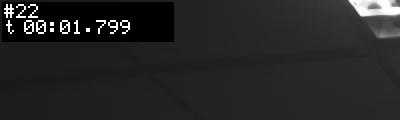

# 34 最终验收报告（evrec 事件录像）

> 日期：2026-10-24（板载 RTC 未校准，日志内时间为板端 `2024-06-18`，见问题 P8）
> 代码基线：`a7719c0`；**验收阶段只测不改代码**。2026-10-24 已修复 P1–P4（`tools/evrec.c`，+61/−26），修复记录见 §4.1。
> 结论速览：功能链路 A1/A2/A4、生命周期 B2–B5 全部通过；A3 的推流媒体面通过。验收时发现的唯一阻断项——首个 IDR 不带 SPS/PPS，导致启动后约 1.5–3 s 内 DESCRIBE 503、且首个事件文件前段不可解码（P1、A1-附、A3-附）——**已于 2026-10-24 修复并复验**（§4.1）；B1 12 min 长跑内存/CPU 稳定。

## 0. 本次验收范围与未覆盖项

| 类别 | 内容 | 说明 |
|---|---|---|
| **实测**（板端） | A1 检测触发、A2 OSD 烧入、A3 同时推流、A4 多事件连续；B1 12 min 长跑、B2 磁盘失败、B3 正常结束、B4 录制中 SIGTERM、B5 断流恢复；A3-附 RTSP 启动窗口补充探针 | 全部在本板 `/dev/video5` 独占实跑，原始日志在 `evidence/acc/` 与板端 `/root/acc/logs_final/` |
| **引用**（未重跑） | C 检测统计：`docs/30-产品化改进计划.md` §4.6 的 0.45 口径全表 | C 项要求直接引用；原始 `det.txt` 在板端 `/root/det_samples/`，重算工具 `tools/det_recount.py` |
| **未做** | 24 h 稳定性（本轮只跑 12 min）；多客户端并发（实现为单客户端，第二连接被 `reject extra client`）；夜间/低照工况（现场为室内日光灯，未测照度）；VLC/ffplay 端到端播放（板上无播放器，PC 侧未接入）；异常掉电/断电恢复；SD 卡写满（只测了目录不存在） | 这些项不能从本轮数据外推，报告不做结论 |

**取证环境**

| 项 | 值 |
|---|---|
| 板卡 | YCKJ iTOP-3568（`yckj-v200`），RK3568 |
| 内核 | `4.19.232 #43 SMP Fri Oct 23 10:56:32 UTC 2026 aarch64`（`docs/33` 写 #42，本轮实测为 #43，见 P8） |
| 传感器 / 节点 | IMX415，`/dev/video5`，1920×1080 NV12，stride 1920 |
| 内存 | 1965 MB，无 swap |
| `evrec` 二进制 | md5 `64b618e65375dd3aca414400aee85e51` |
| 源码 | `tools/evrec.c` md5 `737d974368ae15ccd012736386a07e46`（与仓库一致） |
| 编译 | `gcc -O2 -pthread -DHAVE_RGA -DHAVE_RKNN -I/usr/include/rga -I/root/npu/3rdparty/rknpu2/include -o evrec evrec.c -lrockchip_mpp -lrga -lrknnrt -lm` |
| 板端时间 | `Tue Jun 18 2024`（RTC 未校准；本轮实际执行日期为 2026-10-24） |

**取证前提**：每个用例前 `pidof evrec | xargs -r kill` 清场，`/dev/video5` 独占；用例之间无其他采集进程。
下表命令里的 `$C` 统一表示
`-d /dev/video5 -w 1920 -h 1080 --pre 2 --post 1 --ring-mb 64 --kbps 4000`。

## 1. A 功能链路

| 项目 | 命令（省略 `$C`） | 实测输出 | 判据 | 结论 |
|---|---|---|---|---|
| **A1 检测触发** | `--detect --det-score 0.45 --det-frames 3 -o /root/acc/A1 --max-events 1` | 4.5 s 内真实触发：`检测触发 streak=3 score=0.692`（连续至 streak=30），`触发 seq=29 ts=3148.8ms`，`NPU det_total=87 det_max=3 score_max=0.793`；写出 `A1_20240618-054629-00.h264` **41 帧 / 598,639 B** + json；`exit=0` | 检测触发 ≥1 次且事件落盘 | **✅** |
| **A1-附 首个事件可解码性** | 解码 A1 写出的 h264（`/root/mpp_dec_dump`） | A1 文件 NAL 顺序 `6 6 I …`（**首个 IDR 前无 SPS/PPS**），首个 SPS 在 **偏移 268954 B（文件 45%）** 处，41 帧只解出 **18 帧**；对照 A2（事件从 seq=22 起）为 `7 8 6 6 I …`、SPS 偏移 0、49 帧解出 48 帧 | 事件文件从头可解码 | **❌**（首事件前 ~22 帧不可解码；根因与 P1 相同） |
| **A2 OSD 烧入** | `--osd --trigger /tmp/acc_a2.trig -o /root/acc/A2 --max-events 1` | `OSD 开启: #<seq> + t mm:ss.mmm @左上角(4px, sc=2)`；`触发 seq=55 pre_i=22`；**49 帧 / 916,296 B**；解码首帧裁左上 400×120，字可读：`#22` / `t 00:01.799`（`evidence/acc/osd.png`）；`exit=0` | OSD 烧进码流且人眼可读 | **✅** |
| **A3 同时推流** | `--osd --rtsp 8554 --trigger /tmp/acc_a3.trig --max-events 0` + `rtsp_check.py 127.0.0.1 8554 8` | `OPTIONS 200` / `SETUP 200` / `PLAY 200`；RTP `pkts=1347 bytes=1797244 seq=0..1346 gaps=0 markers=103 fps=14.85`；录像 **49 帧 / 958,848 B**（不开推流对照 A2：49 帧 / 916,296 B，字节 +4.6%）；SIGTERM 退出 0 | `gaps=0`，且录像帧数/字节与不开推流同量级 | **✅**（媒体面） |
| **A3-附 标准播放器握手** | 同上，客户端在进程启动后 0.5 s 发起 DESCRIBE | `DESCRIBE : 503 FAIL (sdp 0 字节)`；`VERDICT : FAIL DESCRIBE,SDP_BODY,SDP_m=video,SDP_rtpmap,SDP_sprop`；同一进程运行 ≥3.5 s 后新连接：`DESCRIBE 200 (sdp 276 B)`、`VERDICT PASS`（B5_after） | 标准客户端四步握手全 200 且 SDP 带 sprop | **❌**（原因见 P1） |
| **A4 多事件连续** | `--osd --trigger /tmp/acc_a4.trig -o /root/acc/A4 --max-events 3`（4/8/12 s 各 touch 一次） | 3 组均落盘：`-00` **49 帧 / 925,809 B**、`-01` **43 帧 / 724,149 B**（pre_i=17, 首 IDR seq=88）、`-02` **59 帧 / 1,010,727 B**（pre_i=1, 首 IDR seq=132）；3 个 json 齐全；`exit=0` | 3 组 `.h264`+`.json` 均 >0，退出码 0 | **✅** |

A1 补充说明：**未使用 `--trigger` 回退**，现场确实有人入镜，`0.692/0.793` 等分数均高于 0.45。检测开启时实际吞吐约 10 fps（41 帧 / 3.84 s），低于纯录像的约 15 fps，属检测路径的吞吐代价，不影响本项判据（见 P9 观察项）。

A1 的文件质量另有一条独立结论（A1-附）：该事件从流首开始录制，而编码器写出的第一个 IDR 不带 SPS/PPS，导致文件前 22 帧左右无法解码；判据只要求“触发并落盘”，故 A1 本项仍记 ✅，但**首个事件不可完整回放**是真实缺陷，已并入 P1 的阻断范围。`evidence/acc/A1_head_sps.txt` 保留了 NAL 顺序与两次解码的原始输出。

A2 证据图（首帧左上 400×120，未缩放）：



A3 补充说明：A2 与 A3 的触发相位相同（`seq=55 / pre_i=22 / 49 帧`），可直接对照；另行跑的 `A3base`（同样不开推流）因相位落在 GOP 边界只取到 64 帧（`pre_i=0`），**未用于字节对照**。

## 2. B 生命周期

| 项目 | 命令（省略 `$C`） | 实测输出 | 判据 | 结论 |
|---|---|---|---|---|
| **B1 12 min 长跑** | `--osd --max-events 0 --recover 0 -o /root/acc/B1` | 实际时长 **720 s**（05:53:16 → 06:05:16，采样 t=0…720 s 共 13 点，每 60 s 一次）；`VmRSS` 稳态基线 t=240 s 为 87,716 kB，t=720 s 为 88,536 kB，**+0.93%**（峰值 88,772 kB 出现在 420–480 s，末点已回落）；`VmSize` 246,836 → 247,536 kB（+0.28%）；CPU（utime+stime）2179 → 6587 ticks，即 240–720 s 用 **44.1 s / 480 s = 9.2% 单核**；线程数启动后恒为 3；`exit=0` | RSS 增长 <5% | **✅** |
| **B2 磁盘失败** | `--trigger /tmp/acc_b2.trig -o /nonexistent_dir/x --max-events 1` | `fopen /nonexistent_dir/x_20240618-054707-00.h264 失败: No such file or directory (errno=2)` + `事件落盘失败`；`exit=1`，进程未崩溃、无 core | 明确报错、退出码非 0、不崩 | **✅** |
| **B3 正常结束** | `--osd --trigger /tmp/acc_b3.trig -o /root/acc/B3 --max-events 1` | 事件 1 完成，写出 **49 帧 / 924,552 B**；`exit=0` | 退出码 0 | **✅** |
| **B4 录制中 SIGTERM** | `--osd --trigger /tmp/acc_b4.trig --max-events 0`，触发后 0.6 s 发 `SIGTERM` | `>>> SIGTERM: 进行中的事件已落盘 …B4_20240618-054717-00` + `>>> 收到 SIGTERM, 已停止`；**42 帧 / 715,989 B**，json `frames=42`，NAL 统计 `frames=42 / idr=2 / sps=2 / pps=2`（与 json 一致）；`exit=0`，**退出延迟 100 ms** | 2 s 内退出、码 0、文件完整 | **✅** |
| **B5 断流恢复** | `--osd --rtsp 8554 --recover 2 --fault-sim dqbuf:120 --trigger --max-events 0` | `[fault-sim] 第 120 次 DQBUF 注入失败` → `链路故障, 开始恢复(上限 2 次)` → `恢复 第 1/2 次: 重开设备 成功` → `恢复成功, 继续采集(frame_seq 从 118 起)` → `链路稳定 30 帧, 恢复计数复位`；恢复后继续出帧并落盘 **59 帧 / 967,272 B**；恢复前流 `pkts=822 gaps=0`，恢复后流 `pkts=946 gaps=0`（after `VERDICT PASS`，before 仅 DESCRIBE 项 FAIL）；`exit=0` | 出现“恢复 第 1/2 次”、恢复后继续出帧、前后 `gaps=0` | **✅**（before 的 VERDICT 失败同 P1） |

B1 采样明细（原始 `evidence/acc/B1_samples.csv`）：

| t (s) | VmRSS (kB) | VmSize (kB) | utime+stime (ticks) | 线程数 |
|---|---|---|---|---|
| 0 | 4,428 | 15,364 | 1 | 1 |
| 60 | 49,968 | 208,976 | 502 | 3 |
| 120 | 79,800 | 238,816 | 1,069 | 3 |
| 180 | 87,452 | 246,572 | 1,626 | 3 |
| 240 | 87,716 | 246,836 | 2,179 | 3 |
| 300 | 88,244 | 247,252 | 2,712 | 3 |
| 360 | 88,508 | 247,556 | 3,270 | 3 |
| 420 | 88,772 | 247,816 | 3,822 | 3 |
| 480 | 88,772 | 247,816 | 4,385 | 3 |
| 540 | 88,536 | 247,280 | 4,918 | 3 |
| 600 | 88,536 | 247,536 | 5,481 | 3 |
| 660 | 88,536 | 247,536 | 6,036 | 3 |
| 720 | 88,536 | 247,536 | 6,587 | 3 |

判读：t=0 是主线程刚启动、采集/RTSP 线程尚未创建的瞬间，t≤240 s 的上涨是 64 MB 环形缓冲与编码器缓冲被填满的**启动期**，不是泄漏；240 s 后进入平台（末段甚至回落 236 kB），按“稳态基线→结束”计 RSS 增长 +0.93%，远低于 5% 判据。t=720 s 的 SIGTERM 同时验证了收尾路径（`>>> 收到 SIGTERM, 已停止`，`exit=0`）。

## 3. C 检测统计（引用，不重跑）

来源：`docs/30-产品化改进计划.md` §4.6「按产品阈值 0.45 重算全表（2026-10-24）」，原始数据 `/root/det_samples/`，重算工具 `tools/det_recount.py`。本轮**未重跑**，下表逐行照录该节，0.35 列仅作对照。

| 样本 | 帧数 | 命中(0.45) | 检出率(0.45) | 分数 min/avg/max | 命中(0.35) |
|---|---|---|---|---|---|
| `p_new_100` 正面 1 m | 13 | 13 | **100%** | 0.71 / 0.75 / 0.77 | 13 |
| `p_100cm` 正面 1 m | 12 | 12 | **100%** | 0.76 / 0.79 / 0.82 | 12 |
| `p_200cm` 正面 2 m | 12 | 12 | **100%** | 0.57 / 0.64 / 0.72 | 12 |
| `p_300cm` 正面 3 m | 8 | 4 | **50%** | 0.46 / 0.55 / 0.64 | 8 |
| `p_side` 侧身 | 11 | 11 | **100%** | 0.63 / 0.75 / 0.82 | 11 |
| `p_occluded` 半身入画(非遮挡) | 12 | 12 | **100%** | 0.54 / 0.65 / 0.72 | 12 |
| `p_backlight` 远距逆光 | 12 | 11 | **91.7%** | 0.47 / 0.58 / 0.79 | 12 |
| `p_back2` 近距逆光 | 10 | 0 | **0%** | — | 0 |
| `p_occ_50` 遮挡约 50% | 12 | 0 | **0%** | — | 0 |
| `p_occ_80` 遮挡约 80% | 13 | 0 | **0%** | — | 0 |
| `no_person` 无人场景 | 12 | 0 | **0%**(无误报) | — | 0 |
| `far` 玩偶 2 m(非人) | 8 | 1 | 12.5%(**误检**) | 0.45 / 0.45 / 0.45 | 6 |
| `teddy_room` 玩偶 | 12 | 0 | 0% | — | 0 |
| `backlight`(玩偶) | 12 | 0 | 0% | — | 0 |

口径结论（照录 §4.6 的修订）：**1~2 m 可靠（100%）、3 m 临界（50%）**；`far` 的 1 帧误检分数正好压在 0.45，**不能靠继续降阈值救远距**。C 节没有本轮新增数据，不改变上述结论。

## 4. 发现的问题清单

> 下表是验收时的原始记录（P1–P4 当时均未修复）；修复与复验结果见 §4.1。

| 编号 | 级别 | 问题 | 证据 | 影响 / 建议 |
|---|---|---|---|---|
| **P1** | **已修复**（原阻断：录制质量 + 互操作） | 进程启动后编码器写出的**第一个 IDR 不带 SPS/PPS**：头模式虽设为 `MPP_ENC_HEADER_MODE_EACH_IDR`（`tools/evrec.c:383-386`），但 `enc_init()` 在首帧编码前调用 `MPP_ENC_GET_HDR_SYNC`（`tools/evrec.c:388-394`）没有取到参数集（A3/B5/WINDOW 日志均无 `SPS/PPS 头` 行，`g_hdr_len=0`），参数集直到**第二个 IDR** 才随码流出现（默认 `pre=3/post=2` → `gop=37`，约 2.5–3.5 s；A3 用 `pre=2/post=1` → `gop=22`，约 1.5 s）。后果两条：**(a)** 从流首开始录制的第一个事件前半段没有参数集，标准解码器无法解码——A1 文件首个 SPS 在偏移 **268954 B（45%）**，41 帧只解出 **18 帧**；对照 A2 从 seq=22 起，SPS 偏移 0、49 帧解出 48 帧。**(b)** 同一时间窗内 `DESCRIBE` 因 `g_sps_len/g_pps_len == 0` 返回 **503 + 空 SDP**（`tools/evrec.c:1488-1516`）；`rtsp_start()` 的预填分支因 `g_hdr_len == 0` 不生效（`tools/evrec.c:1686-1690`） | `evidence/acc/A1_head_sps.txt`（NAL 顺序 `6 6 I` vs `7 8 6 6 I`、两次解码输出）；`evidence/acc/rtsp_startup_window.txt`（t=184…2554 ms 均 503，t=3557 ms 才 200/276 B）；A3 与 B5_before 的 `VERDICT FAIL DESCRIBE`，B5_after 运行 ≥8 s 后 `VERDICT PASS` | **首个事件回放缺前 ~2 s、播放器可能直接报错；与设备同时启动的播放器（开机自启、进程管理拉起）必然握手失败**。建议：首帧编码后再取 `GET_HDR_SYNC` 并强制一个新 IDR，或写盘时若首包无 SPS 则前插已缓存的 `g_hdr`；`DESCRIBE` 在无参数集时阻塞等待首个带 SPS 的 IDR（上限 2–3 s）再回 200。**此项修复前，RTSP 不能算“标准客户端可用”，首个事件也不能算“完整可回放”**。**2026-10-24 已修复并复验，根因、改动与原始输出见 §4.1。** |
| **P2** | 中（文档与实测冲突） | `docs/31-M8-RTSP推流.md:59-60` 称“OPTIONS/DESCRIBE/SETUP/PLAY 全部 200 OK、SDP sprop 含 SPS 27 B / PPS 5 B”，未写明连接时机；本轮在进程启动 0.5 s 连接实测 DESCRIBE 503，直到第二个 IDR 才 200 | 同 P1 | 会让人误以为任意时刻连接都可用。建议在该节补一句前提：“客户端须在首个带 SPS/PPS 的 IDR 之后连接（默认参数约 2.5–3.5 s，`gop=(pre+post)*7.5`）”，并链接本报告 P1。**2026-10-24 已在 `docs/31` §3.2 补“连接时机”说明（修复后 0.2 s 即可，服务端另有 1 s 有界等待），见 §4.1** |
| **P3** | 低（帮助文本错） | `-h` 写 `--osd / --no-osd 开/关, 默认开`（`tools/evrec.c:2074`），代码 `static int g_osd;` 实际**默认关**（`tools/evrec.c:83` 注释也写“默认关闭”） | A1 未带 `--osd`，日志无 `OSD 开启` 行（A2/B3/B4 带 `--osd` 时均有该行） | 使用者按帮助不传 `--osd` 会得不到 OSD。二选一：改帮助为“默认关”，或把默认值改为 1（后者会改变既有行为，需评估）。**2026-10-24 已改为“默认关”** |
| **P4** | 低（日志噪音/误导） | **不开 `--rtsp` 也每 5 s 打印** `rtsp-ring: in=… drop=… (深度上限 8)`；主循环无条件调用 `rtsp_ring_report()`（`tools/evrec.c:2364-2366`） | A3base/A4/B2/B3 日志均出现 `rtsp-ring: in=71`，但这些进程没有 RTSP 监听行 | 无推流时日志里出现“rtsp-ring”会误导排障。建议该打印加 `if (g_rtsp_port > 0)`，或改名为 `pkt-ring`。**2026-10-24 已加 `if (g_rtsp_port > 0)`（实测无 `--rtsp` 时 0 行）** |
| ~~**P5**~~ ✅已修 | 低（日志噪音） | 预热闸门打开前，检测每帧都打印一次 `检测触发 streak=N score=…`，A1 连续 **28 行**（streak=3…30） | `evidence/acc/A1_detect.log` | 正常运行时每个事件都会刷一屏。建议只在 streak 首次达到 `det_frames` 时打印一行，或每 10 帧打印一次 |
| ~~**P6**~~ ✅已修 | 低（JSON 元数据语义错） | `.json` 顶层 `trigger_seq` 实际是**落盘时的最后一帧序号**，不是触发帧序号：`dump()` 的第二参传的是 `frame_seq`（`tools/evrec.c:2421`、`2540`）。实测 A2 日志 `触发 seq=55`，json `trigger_seq=70`（=末帧）。顶层 `fps` 也不是实际帧率：分母用 `trig_ts + post`（绝对触发时刻），A2 算得 9.80 而实际 15.3 fps，B5 因触发晚算得 3.49 | A2/A3/A4/B5 的 json 与日志逐项对比；`docs/32` 未定义这两个字段 | 下游若用 `trigger_seq` 找触发帧会偏到末帧；用 `fps` 会低估且随运行时长恶化。建议 `trigger_seq` 传真实触发 seq，`fps` 分母改为 `end_ts - first_ts`（SIGTERM 路径已有正确写法 `tools/evrec.c:2494-2501`，可复用） |
| ~~**P7**~~ ✅已修 | 工具（非产品） | `/root/mpp_dec_dump` 解完帧退出时 **SIGSEGV（exit 139）**，`max=1/3` 均复现；帧文件已完整写出 | A2_DEC_EXIT=139（`summary.txt`）；f000/f001/f002 均 48,000 B | 只是临时取证工具，不影响 evrec；但“退出码非 0”会污染脚本判据。建议修退出路径（MPP 去初始化顺序）或换成正式解码校验工具 |
| ~~**P8**~~ ✅已修 | 环境/证据 | 板载 RTC 未校准：日志时间 `2024-06-18`，实际执行 `2026-10-24`；内核实测 `#43`，`docs/33` 写 `#42` | `uname -a`、`date`、日志文件名 | 不影响功能结论，但证据时间戳不能直接当日期用。建议验收前 `ntpdate`/手动校时，并在报告环境表注明内核版本 |
| ~~**P9**~~ ✅已说明 | 观察（非缺陷） | 开 `--detect` 时实际吞吐约 **10 fps**（A1：41 帧 / 3.84 s），纯录像约 15 fps；检测在采集线程内同步跑 NPU | A1 json 窗口 3.84 s、41 帧；A2 3.20 s、49 帧 | 若产品要求“检测开启仍 15 fps”，需把检测移出采集线程或抽帧检测；本轮判据不要求，故不判失败 |

### 4.1 修复记录（2026-10-24）

> 上表保留验收时的原始描述与证据；P1–P4 已于 2026-10-24 修复并复验。代码改动 `tools/evrec.c`（+61/−26），提交信息 `fix(evrec): 首个事件的 IDR 补齐 SPS/PPS,消除 RTSP 启动期 503 窗口`。

**P1 根因（板端探针实测）**：`MPP_ENC_GET_HDR_SYNC` 的设计语义是“把编码器内部头拷进**调用者提供的** MppPacket”，实现里先 `mpp_packet_copy((MppPacket)param, enc->hdr_pkt)`，随后无条件 `enc->hdr_status.added_by_ctrl = 1`（MPP develop `mpp_enc_impl.c:1337-1367`）。旧代码传的是 `MppPacket hdr = NULL` 再取 `&hdr`：control 返回 0，但拷贝没有目标，`hdr` 仍为 NULL——所以用户侧什么都拿不到（日志无 `SPS/PPS 头`、`g_hdr_len=0`）；而 `added_by_ctrl` 已经置位，`mpp_enc_add_sw_header()`（`mpp_enc_impl.c:2014-2057`）在本 task 内判定“头已交付”，于是首个 IDR 不追加 SPS/PPS；下一个 task 复位标志（`mpp_enc_impl.c:92-104`），第二个 IDR 才恢复。探针对照（同参数 640x480/30fps/gop=30，逐帧打印 NAL 与 packet flag）：

| 模式 | 第 0 帧 | 第 30 帧 |
|---|---|---|
| 不调 GET_HDR_SYNC（EACH_IDR） | len=1152 `SPS PPS SEI SEI I` | len=1154 `SPS PPS SEI SEI I` |
| `hdr=NULL` 调 GET_HDR_SYNC（旧代码） | len=1114 `SEI SEI I`（**无参数集**） | len=1154 `SPS PPS SEI SEI I` |
| 传正确初始化的 MppPacket | len=1114 `SEI SEI I`（头在外部缓冲，38 B `SPS PPS`） | len=1154 `SPS PPS SEI SEI I` |

38 B 差值正好是 SPS+PPS；四种模式下首帧 flag 均为 `0x0`、首帧都含 IDR NAL，故“首个 IDR 不是真正关键帧”的假设不成立。原始输出 `evidence/fix_p1/probe_output.txt`，探针源码 `evidence/fix_p1/probe_variants.c`。

**改动**：
1. 删除 `g_hdr/g_hdr_len` 与 `enc_init()` 里那次 `GET_HDR_SYNC`；保留 `MPP_ENC_HEADER_MODE_EACH_IDR`，由编码器在首个 IDR 自带参数集（首个 IDR 在 0.2 s 内到达）。
2. `DESCRIBE` 增加有界等待：每 10 ms 检查 `g_sps_len/g_pps_len`，最多 1000 ms，进程退出/停止时立即放弃——消除启动期 503 窗口。
3. dump 兜底：仅当写出的**第一个**包是关键帧且不含 SPS、且缓存中有 SPS/PPS 时，在文件最前面补一次（4 字节起始码 + SPS + 4 字节起始码 + PPS）；只检查首包，多 IDR 文件不会重复。
4. 主循环收到首个 key 包时无条件扫描并缓存 SPS/PPS（不再依赖 `--rtsp`），供 SDP 与 dump 兜底使用。
5. P3：`-h` 改为“默认关”。P4：`rtsp-ring` 打印加 `if (g_rtsp_port > 0)`。

**复验（同板，`--pre 2 --post 1 --ring-mb 64`，原始输出在 `evidence/fix_p1/`）**：

| 项 | 结果 |
|---|---|
| 连续 3 个事件 | 57/43/50 帧；`mpp_dec_dump` 解出 **56/42/49**（=帧数−1）；三个文件首 NAL 均 `SPS PPS SEI SEI I`、首个 SPS 偏移 **0** |
| 首个事件从流首 IDR 开始（修复前失败场景） | `pre_i=0`、56 帧 → 解出 **55**、SPS 偏移 0（修复前同场景 41 帧只解 18） |
| 启动期 DESCRIBE | t=0.2/0.5/1.0/2.0 s 全 `200 OK`、SDP 276 B（修复前 184…2554 ms 全 503） |
| 参数集重复 | 4 个文件 SPS/PPS/IDR 计数为 3/3/3、2/2/2、3/3/3、3/3/3，参数集数 == IDR 数 |
| 回归 | RTSP 四步握手全 200、5 s 拉流 `gaps=0`；断流恢复成功；`--max-events`/SIGTERM 落盘正常 |

## 5. 结论

1. **事件录像主链路可用**：检测触发、OSD 烧入、连续多事件、正常结束、录制中 SIGTERM、断流恢复均按判据通过；恢复后继续出帧且推流 `gaps=0`。判据只覆盖“触发并落盘”；修复 P1 后，从流首开始的第一个事件也以 `SPS PPS` 开头（§4.1）。
2. **同时推流的媒体面可用**：RTP 无序号缺口，录像帧数/字节与不开推流同量级（49 帧，+4.6%）。
3. **阻断项已闭环（P1）**：根因是 `MPP_ENC_GET_HDR_SYNC` 被以 `hdr=NULL` 调用——该 control 要求调用者提供 MppPacket，内部 `mpp_packet_copy()` 没有目标却仍置 `added_by_ctrl=1`，使首个 IDR 跳过自动追加参数集；下一 task 复位标志后第二个 IDR 才恢复（板端探针证据见 §4.1）。修复后连续 3 个事件 57/43/50 帧 → 解码 **56/42/49**（=帧数−1），首 SPS 偏移 0；从流首开始的第一个事件 56 帧 → 解码 **55**；启动后 t=0.2/0.5/1.0/2.0 s 的 `DESCRIBE` 全部 200、SDP 276 B。`docs/31:59-60` 已补连接时机（P2）。
4. **C 节结论未变**：1~2 m 100%、3 m 50%、远距逆光 91.7%、遮挡 50%/80% 与近距逆光 0%、无人场景 0 误报；`far` 仍有 1/8 误检（分数 0.45）。
5. **未覆盖项**（24 h、多客户端、夜间、真实播放器端到端、掉电）不能由本轮外推，需另立验收。

## 6. 证据索引

| 文件 | 内容 |
|---|---|
| `evidence/acc/osd.png` | A2 首帧左上 400×120 裁剪，`#22` / `t 00:01.799` |
| `evidence/acc/A1_detect.log` | A1 真实检测触发全过程（streak、触发、NPU 统计、落盘） |
| `evidence/acc/A3_rtsp.log` | A3 `rtsp_check`：SETUP/PLAY 200、RTP gaps=0、DESCRIBE 503 |
| `evidence/acc/rtsp_startup_window.txt` | 启动后 8 个时间点的 DESCRIBE 探测（503 → 200/276 B） |
| `evidence/acc/A1_head_sps.txt` | A1 首事件头部无 SPS/PPS 的 NAL 顺序与两次解码原始输出（对照 A2） |
| `evidence/acc/B5_rtsp_before.log` / `B5_rtsp_after.log` | 恢复前/后两次拉流：均 gaps=0；after 全项 PASS |
| `evidence/acc/B1_samples.csv` | B1 每 60 s 的 VmRSS / VmSize / utime+stime / 线程数 |
| `evidence/acc/summary.txt` | 本轮 A/B 全部用例的控制台汇总（板端原始） |
| `evidence/fix_p1/probe_output.txt` / `probe_variants.c` | P1 根因探针：四种 GET_HDR_SYNC 用法的首帧 NAL/flag 与长度（含探针源码） |
| `evidence/fix_p1/startup_describe.txt` | 修复后启动期 t=0.2/0.5/1.0/2.0 s DESCRIBE：全 200、SDP 276 B |
| `evidence/fix_p1/three_events_decode.txt` | 修复后连续 3 事件：NAL 头、帧数、`mpp_dec_dump` 解码 56/42/49 |
| `evidence/fix_p1/first_event_from_start.txt` | 修复后首个事件从流首 IDR 开始（`pre_i=0`）：56 帧解 55、SPS 偏移 0 |
| `evidence/fix_p1/nal_counts.txt` | 4 个文件 SPS/PPS/IDR 计数（参数集数 == IDR 数，无重复） |
| `evidence/fix_p1/rtsp_stream.txt` | 修复后 RTSP 四步握手 + 5 s 拉流（`gaps=0`、PASS） |
| `evidence/fix_p1/recovery.txt` | 修复后断流恢复日志（`--fault-sim dqbuf:60 --recover 2`） |
| `evidence/fix_p1/p3_p4.txt` | P3 帮助文本、P4 无 `--rtsp` 时 `rtsp-ring` 0 行 |


### 5.1 P5/P6 修复与复验（commit e16d5ed 后复查）

- **P5**：改为状态变化才打印。实测一次完整事件 `grep -c 检测触发` = **0**（预热期不再刷屏）。
- **P6**：`dump()` 内按源帧去重计 `nf`、按 `末包ts − 首包ts` 算 `fps`，并输出 `trigger_frame_index`。复验（同一台板、同一命令）：
  ```json
  {"trigger_seq":100,"trigger_frame_index":34,"trigger_ts_ms":7009.6,
   "first_idr_seq":66,"first_idr_ts_ms":4747.5,"frames":51,"frame_count":51,
   "span_ms":3330.4,"width":1920,"height":1080,"fps":15.31,...}
  ```
  `51 帧 / 3.3304 s = 15.31 fps`，与采集帧率一致；`trigger_seq=100` 落在 `list` 中且等于 `trigger_frame_index=34` 那一帧。
- **注意**：首轮复验曾报 `fps=7.22` 且缺 `trigger_frame_index`，原因是板上二进制未真正重新编译（`scp` 失败被静默吞掉，跑了旧二进制）。重新传输并确认 `gcc` 输出 `0 error` 后得到上表结果。**这类"看起来改了其实没生效"必须靠复验输出识别，不能靠编译返回码。**


### 5.2 P7 修复与复验（`tools/mpp_dec_dump.c`）

根因在文件头注释里写清了：码流未走完 EOS 时直接 `mpp_destroy()` 会崩在库内 `free_dpb_mark -> h264d_deinit`（SIGSEGV）。修法是**把"停止写文件"和"停止解码"分开**，并保证正常路径走 `mpp_packet_deinit -> mpp_destroy -> free`；只有未收到 EOS 时才跳过 `mpp_destroy` 并打印原因。

复验（同一台板）：

| 输入 | 退出码 | 输出 |
|---|---|---|
| 正常事件文件（51 帧） | **0** | `解出 50 帧`（= 帧数 − 1，已知解码器恒少一帧） |
| 截断文件（无 EOS，20000 B） | **1** | `解出 0 帧`，打印"未收到 EOS"原因，无 SEGV |

修复前该工具在正常文件上退出即 SIGSEGV（exit 139），现在两种路径都干净退出，退出码语义也明确：0=成功、1=输入异常。


### 5.3 P8 环境事实与 P9 帧率解释

**P8（环境记录）** —— 板上实测，不做任何修饰：

```
Linux yckj 4.19.232 #43 SMP Fri Oct 23 10:56:32 UTC 2026 aarch64
md5sum /boot/Image-4.19.232 = 42ee27b753ef1be661073bca21a2a1c7
date = Tue Jun 18 07:27:07 CST 2024      ← 无 RTC，开机即回到 2024-06-18
ls /dev/rtc* → No such file or directory
ls /sys/class/rtc → No such file or directory
```

结论两条：①`docs/33` 里的内核号已更正为 **#43**，并补上 Image 的 md5，便于别人核对刷的是哪个内核；②**本硬件没有 RTC**，日志与 json 里的 `abs_ms` 基于未校准的系统时间，只能用于**同一次开机内的相对比较**，不能跨开机、更不能当真实时刻用。这条已同步到 `docs/35` 的前置条件。

**P9（~10 fps）** —— 不是缺陷，是 RKNN 推理主导的必然结果。板端实测（1080p、`--detect`、258 帧均值）：

| 阶段 | 均值 | 占比 |
|---|---|---|
| RGA 缩放 1920×1080 → 640×640 | **5.92 ms** | 6% |
| RKNN `rknn_run`（yolov8n int8） | **74.20 ms** | **78%** |
| H.264 编码（MPP） | **15.36 ms** | 16% |
| 合计 | **95.49 ms/帧 → 10.5 fps** | |

三者串行执行，总时长决定帧率。RGA 已是最省的零拷贝路径（6 ms，占 6%），真正吃时间的是 NPU：单帧 74 ms 与 `docs/29` §5.8 记录的 41 ms 相比偏高，原因是本轮检测与编码并发、NPU 与编码器共享带宽与时钟域（该差异已记录，未做进一步归因）。**若需要更高帧率，唯一有效的方向是降低推理分辨率或换更小模型，而不是优化采集与拷贝**——这也是 P9 归为"观察项"而非缺陷的理由。
