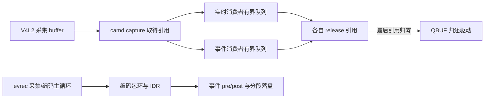
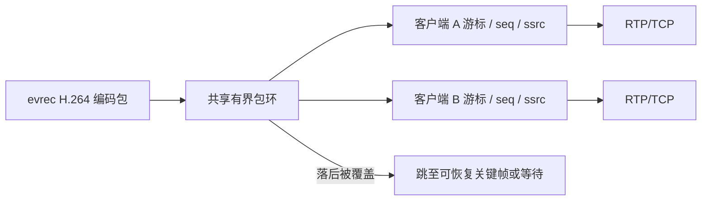
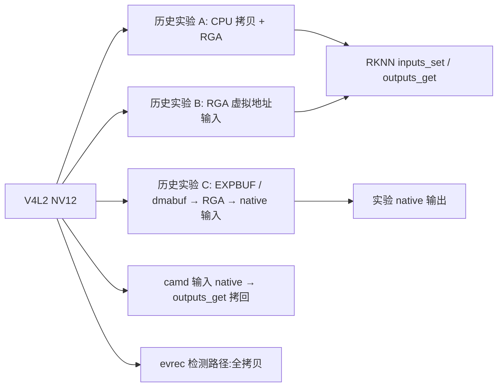

# 岗位能力对照：从问题、代码到证据

本页把项目与嵌入式软件岗位相关的工作串起来。历史记录与本轮复核分开；当前仓库的后续驱动修改仍未部署、未板测。项目使用 AI 辅助脚手架、测试和文档；硬件现场核对、方案取舍、刷写授权和验收由人负责。回答时只认能够追溯的个人工作和实际证据，不把计划说成结果。

## 从岗位要求找到实现

| 岗位关注点 | 实现、文档与证据 | 一句话讲法 | 人做了什么 |
|---|---|---|---|
| C/C++、资源与并发 | [camd](../tools/camd.c)、[主机替身测试输出](../evidence/2026-11-05-板测复核/host-tests.log) | 用有界队列、引用计数和统一清理路径管理采集 buffer 的生命周期。 | 审阅队列容量取舍与失败后的验收边界。 |
| 网络、音视频与协议 | [RTSP hub](../tools/rtsp_hub.c)、[历史多客户端板测](../evidence/2026-10-29-H5板测/README.md) | 编码包进入共享环，每个客户端独立游标和 RTP 状态，慢客户端单独处理。 | 决定慢客户端可丢包而不反压采集，检查协议与解码证据。 |
| Linux 驱动与接口 | [OV8858 subdev 驱动](../driver/ov8858_sm/ov8858_sm.c)、[内核问题复盘](28-内核问题闭环.md) | 从 I²C、设备树与上电时序走到 V4L2 subdev 的格式、控制和流生命周期。 | 核对物理口与总线，确定每次板端操作的恢复与授权边界。 |
| 故障定位 | [物理口复盘](09-L1A-I2C调试复盘-物理口与总线映射.md)、[冷启动台账](../evidence/2026-10-27-上电调试/cold-boot-ledger.csv) | 先固定重现条件，再沿物理连接、拓扑、驱动和用户态逐层排查。 | 现场确认物理连接、保留失败记录并设回归门槛。 |
| 稳定性与回归 | [历史 camd 回归](../evidence/2026-10-23-camd/regress_1023b_report.md)、[本次短测](43-板测复核报告.md) | 连续出帧、资源归还与异常日志是不同维度，必须分别验证。 | 确定测试条件；本次错误日志未闭环，暂停进一步采流等待裁决。 |
| 工程化 | [systemd、自检与版本闸门](archive/24-M4-工程化.md)、[3A 运行纪律](35-验收环境与复现命令.md) | 对运行环境做版本与拓扑核对，并保留独立的失败和恢复路径。 | 决定验收闸门、保留回退路径并对涉及刷写的操作逐次批准。 |

## 三张图：各自的真实边界

### 采集队列与事件录像



设计取舍：`camd` 和 `evrec` 是两个不同工具；图中两条路径不是同一实现。依据：[camd 引用释放](../tools/camd.c)、[evrec 编码包环](../tools/evrec.c)。

为什么：有限 buffer 不能被慢消费者无限占用；事件录像需要从可解码的关键帧组织切片。

边界：主机替身验证了特定故障和资源路径，真实设备及固定输入字节一致性仍待板测。

### 多客户端 RTSP



设计取舍：每客户端有自己的游标和 RTP 状态；慢客户端的跳过或淘汰独立统计。[代码](../tools/rtsp_hub.c) · [历史板测](../evidence/2026-10-29-H5板测/README.md)。

为什么：防止单个客户端的发送速度直接决定采集速度；H.264 丢包恢复要考虑 SPS/PPS 与 IDR。

边界：未完成四客户端满载长跑；旧延迟结论对应已退役 `cam_rtsp`，不能当作现版 `evrec` 复核结果。

### 输入与输出的三种口径



设计取舍：按程序与输入/输出分别说清楚；[实验代码](../zerocopy/zc_npu.cpp)和 [输入 native 对照](../evidence/2026-10-25-质量保障线/fv_ab_input_only.json) 不可混成一个产品指标。

为什么：减少 CPU 搬运能释放余量，但硬件执行、同步与内存格式仍要测。

边界：[输出 native 字节对照未通过](../evidence/2026-10-25-质量保障线/fv_ab2.json)，根因未确认；本轮三模式复核遇到 RGA 兼容模式日志而中止，见 [复核记录](43-板测复核报告.md)。

## 面试追问与回答要点

### C/C++、面向对象与资源管理

1. **C 如何表达对象的生命周期？** 用结构体承载状态、初始化与清理函数约定所有权；出错路径也要覆盖，见 [camd](../tools/camd.c)。
2. **线程和进程分别共享什么？** 同一进程内线程共享地址空间和文件描述符表；跨进程要显式 IPC。结合项目解释队列锁与设备 fd 的归属，不声称项目有完整的跨进程框架。
3. **`volatile` 能代替锁吗？** 不能；它不提供线程间原子性和同步关系。数据竞争用 mutex 或 C 原子操作，信号处理限制另谈。

### 双消费者与 buffer

1. **为什么归还驱动要等最后一个引用？** 任何消费者仍在读时重新 QBUF 可能被硬件覆盖；`node_release` 在引用归零时归还，见 [代码](../tools/camd.c)。
2. **buffer 与队列深度怎么选？** 项目按 `nbufs ≥ rt_depth + ev_depth + 2` 给容量告警；这是本实现的预算，不是所有 V4L2 程序的通用定律。[源码与边界说明](archive/29-可靠性工程.md)。
3. **慢消费者会怎样？** 说明当前配置的阻塞/丢弃策略与各自计数；主机替身只能验证部分故障与恢复，[历史对照](../evidence/2026-10-23-camd/regress_1023b_report.md) 和真机验证分开讲。

### RTSP、H.264 与网络

1. **NAL 太大怎么传？** 代码对长 NAL 做 FU-A 分片，RTP 序号按客户端递增；[socketpair 替身](../tools/tests/rtsp_wire_test.c)核对字节。
2. **慢客户端和超额连接怎么处理？** 客户端游标落后可被逐出并等待可恢复帧；超出配置上限返回 RTSP 453，见 [hub](../tools/rtsp_hub.c)。历史[双客户端记录](../evidence/2026-10-29-H5板测/README.md)不能外推满载长跑。
3. **延迟数字怎么解释？** 历史文档的 18.9 ms 是均值，p95 是 19.9 ms，不含播放器解码和缓冲；当时是板内 loopback、旧 `cam_rtsp`，[原文](archive/RTSP推流-M8.md)。对应逐帧原始附件尚未定位，当前不能独立复核，也不能写成现版端到端 p95。

### platform driver、DTS、V4L2 与 I²C

1. **platform 和 I²C 驱动边界？** 描述控制器/总线与挂在总线上的 sensor；DTS 给出设备和资源，具体绑定仍由匹配表和总线枚举决定。看 [sensor 驱动](../driver/ov8858_sm/ov8858_sm.c)。
2. **subdev 与 video 节点区别？** sensor subdev 暴露格式和控制，采集 video 节点由下游采集/ISP 产生；链路靠 media topology 连接，[本轮只读拓扑](../evidence/2026-11-05-板测复核/A1-topology.log)。
3. **I²C 扫不到先做什么？** 先核对物理座与总线，再看供电、时序和地址；不要仅凭节点存在判断芯片响应。[误判复盘](09-L1A-I2C调试复盘-物理口与总线映射.md)。

### 内核异常与回归

1. **TRY_FMT 和 ACTIVE 有什么区别？** 前者协商临时状态、后者影响当前配置；空 cfg/非法 pad 的处理必须按调用路径检查。[问题闭环](28-内核问题闭环.md)。
2. **compat/Oops 能否写成已修复？** 不可以。独立 rkcif 空指针防护补丁仍是静态审阅、未部署；历史 compliance Oops 不能概括成全项通过。[事故与边界](archive/36-硬件事故与恢复手册.md)。
3. **如何说明稳定性？** 历史报告有 300 次开关流和 1800 帧回归；本次仅 100 次取得首帧，内核出现错误字样且原因未闭环，[历史报告](27-稳定性回归.md) · [新记录](43-板测复核报告.md)。不要把单板短测说成长期可靠性证明。

### systemd、3A 与能力边界

1. **为什么要版本闸门？** 避免 server、库与 IQ 文件不配套；按 [工程记录](archive/24-M4-工程化.md) 解释校验对象，不能仅凭文件存在说算法正常。
2. **运行采集中能否停止 3A？** 不可以把它当普通后台进程随意停止；当前 boot 的生命周期纪律与恢复见 [验收命令](35-验收环境与复现命令.md)。
3. **OV8858 做过完整 ISP IQ 吗？** 没有。它走 CIF RAW10；mini3a 是软件闭环，不等于完整 ISP tuning。未做 24h 长稳、功耗和 Android HAL3 实操；[板测计划](archive/板测计划与预设判据.md)是计划而不是结论。

## 可以复制的无板测试（需 Linux）

需 Linux 环境（如 Linux VM 或 CI），在仓库根目录执行；以下使用独立临时输出，**这些都是主机替身，不是板测**。本轮在 VM 实际运行及完整输出见 [host-tests.log](../evidence/2026-11-05-板测复核/host-tests.log)，日志里的 `FATAL` 是有意注入的失败场景。

```sh
gcc -std=c11 -O1 -pthread tools/tests/rtsp_wire_test.c -o /tmp/rtsp-wire
/tmp/rtsp-wire
# 预期包含 RTP single and fragmented NAL bytes: PASS

gcc -std=c11 -O1 -g -pthread -fsanitize=address,undefined tools/tests/camd_host_test.c -lm -o /tmp/camd-host
/tmp/camd-host
# 预期包含 30 fault/recovery pairs: max concurrent samplers=1 PASS

python3 tools/tests/test_evrec_host.py
# 预期 event、qbuf、rga-only、rga-rknn 各 PASS；替身编译可能产生 warning

python3 tools/tests/test_evrec_preload.py
# 预期普通和 fortified 各故障场景 PASS，进程退出 0
```

测试不能证明真实 V4L2/RGA/RKNN 行为、板端动态库拦截或长时间可靠性；具体板测前置见 [计划](archive/板测计划与预设判据.md)。
