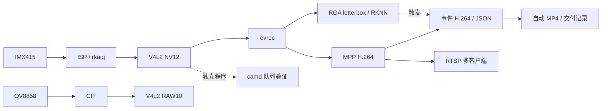

# 系统架构

主服务在 RK3568 厂商 Linux BSP 上使用 IMX415；OV8858 提供独立驱动与 RAW 采集支路：

图中 `evrec` 和 `camd` 是各自使用采集节点的不同程序，不表示它们能同时独占同一节点。IMX415 使用 ISP 与 rkaiq 3A；OV8858 走 CIF RAW10，不能描述成经过完整 ISP/IQ 调优的彩色链路。实际节点与运行镜像需要现场核对。

[`mini3a`](../../mini3a/README.md) 独立验证图像统计、曝光/增益和ISP params控制接口，不能与rkaiq同时控制链路。本轮AE有真实响应；AWB效果未被证明，主服务图像控制继续由rkaiq承担。

`evrec --detect` 在采集帧上运行 RGA 预处理和 RKNN/NPU 推理，检测命中可触发事件录像；不启用检测时也可以手动触发。`camd` 的检测与队列、`zerocopy/` 的三种输入输出路径是不同实验，不能合并为当前程序全链路零拷贝。

OV8858 的 RAW10 可直接原始落盘，布局和 stride 正确时可离线统计或转换；普通彩色图像还需 Bayer 解包、去马赛克等处理。历史 `zc_dual.cpp` 只把 Bayer 高位样本当作单通道再转 RGB 格式，不是完整彩色处理，不代表已验证该路目标检测效果。

驱动入口为 [OV8858 V4L2 subdev](../../driver/ov8858_sm/ov8858_sm.c)；[事件录像](../pipeline/event-recording.md)用编码包环保存预录内容，[RTSP 服务](../pipeline/rtsp-multiclient.md)处理多客户端。[可靠性记录](../stability/reliability.md)说明采集线程、队列与 buffer 归还；其历史实验结果不能自动外推到当前版本。

布线、I²C 地址和接入步骤见 [物理口排查](../bringup/i2c-debug.md)与[硬件操作记录](../bringup/hardware-guide.md)；[验收总览](../acceptance/summary.md)区分历史结果和未验证内容。
