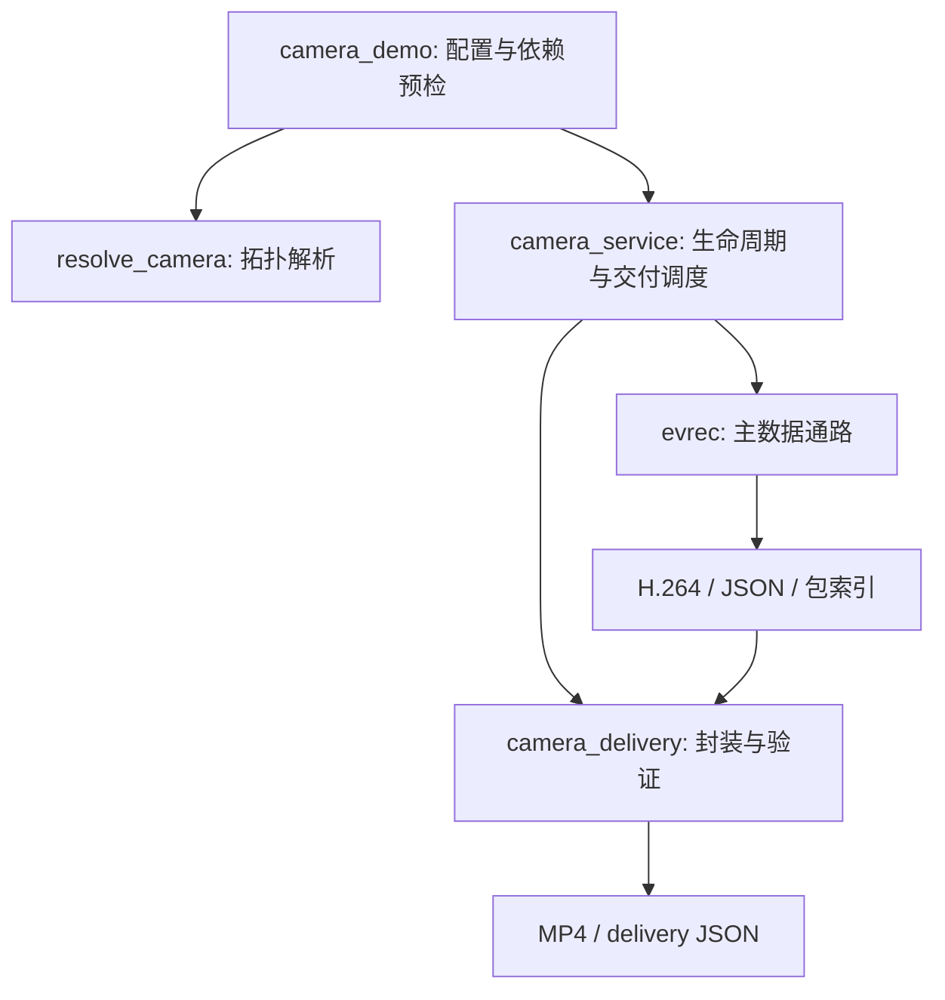
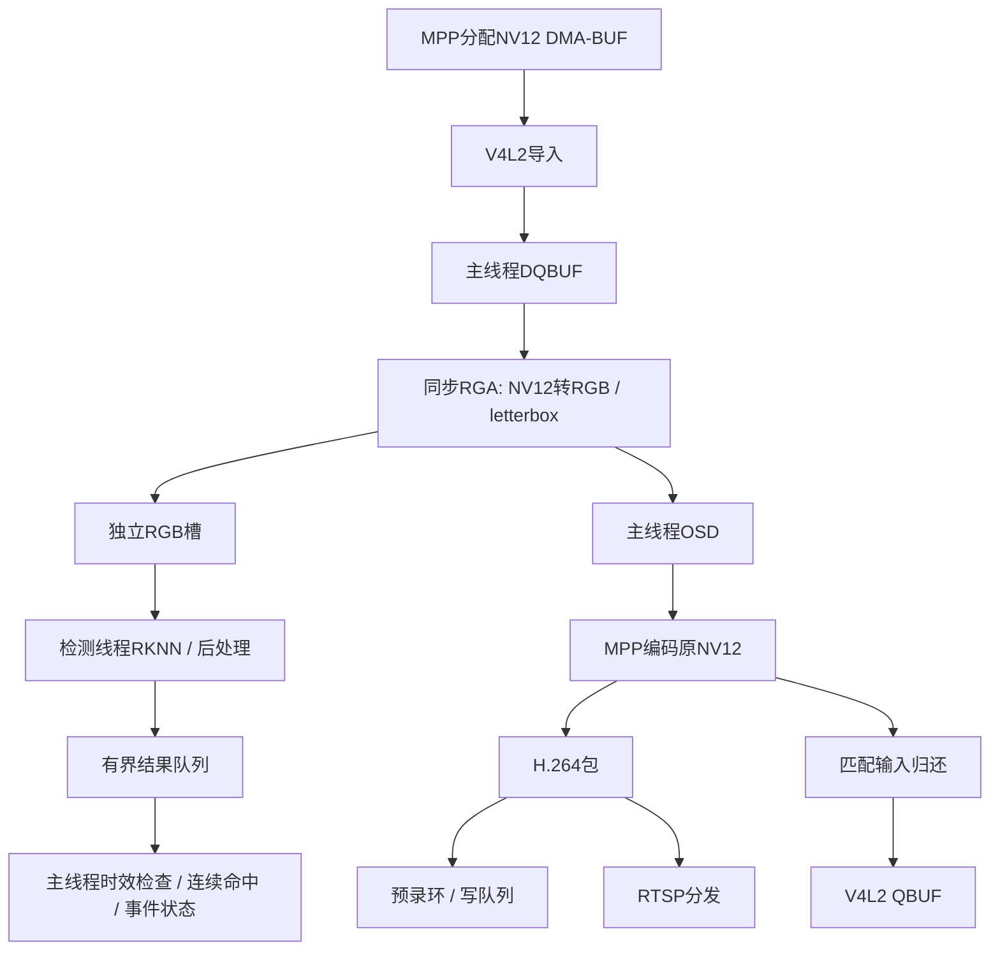

# 系统架构与数据链路

主服务面向固定机位、人员停留秒级的室内入口留证。当前性能场景为IMX415、1080p NV12、标称15fps、pre3/post2秒、最多两个RTSP观看端。目标是保留前情、保持视频连续、控制检测结果年龄并核对交付完整性。

## 硬件与控制通路

IMX415、CSI和ISP使用厂商BSP驱动。rkaiq是控制通路，不承载应用NV12帧；V4L2给应用的是ISP处理后的图像。媒体拓扑用来解析实际节点，避免跨设备硬编码video编号。

OV8858另经sensor/CIF/SDITF/ISP虚拟通道接入，包含仓库自有subdev驱动。双实例共享物理ISP/NPU，不是同步双目；[历史双路](../pipeline/dual-camera.md)与当前单路流水线分开。

## 进程职责

| 模块 | 职责与源码 |
|---|---|
| camera_demo | [配置和依赖预检](../../tools/camera_demo.cpp)，核对设备、3A、端口、模型与能力，保存实际argv |
| resolve_camera | [媒体拓扑解析](../../tools/resolve_camera.cpp)，按sensor profile找到采集节点 |
| camera_service | [生命周期与交付调度](../../tools/camera_service.cpp)，最多32项待办/在途交付、单交付进程 |
| evrec | [采集、事件与编码](../../tools/evrec.c)，组织推理、写入和RTSP线程 |
| camera_delivery | [独立交付](../../tools/camera_delivery.cpp)，核对包索引、大小、帧数和哈希并封装MP4 |

C++入口不依赖Python；FFmpeg/FFprobe仍是交付依赖。Python主要用于测试、数据分析和历史工具。

## 一帧的生命周期

1. 共享NV12由MPP分配、V4L2导入，不是本路径由V4L2先导出。DQBUF后应用持有该帧使用权。
2. 主线程同步完成RGA，输出到独立RGB槽。worker不再持有原NV12，所以主线程可继续OSD与编码。
3. 编码输出包已到手不等于输入可回队。`shared_return_input()`匹配task、frame、PTS及buffer后才QBUF，防止驱动覆盖仍被MPP使用的输入。
4. copy路径复制后可较早QBUF；共享路径减少选定整帧复制，原采集buffer持有更久。
5. RKNN仍使用UINT8/NHWC/pass_through=0，运行库可以做转换；RGA/RKNN输入共享不是native直通或整条链路零拷贝。编码包分发也仍有复制。

## 线程、容量与过载

[`evrec_pipeline.h`](../../tools/evrec_pipeline.h)提供交接，[`evrec_detect_pipeline.h`](../../tools/evrec_detect_pipeline.h)集成来源与业务策略。主线程组织采集、RGA、编码和事件；没有另建独立采集线程。RKNN context由一个检测线程独占。

| 资源 | 契约与满载行为 |
|---|---|
| 两个RGB槽 | FREE→WRITING→READY→RUNNING→FREE；只替换READY，绝不覆盖RUNNING |
| 一个待处理输入 | 保留新目标、减少旧图排队；替换记为检测损失，不能与视频丢帧混算 |
| 八项结果队列 | 主线程消费；溢出或推理错误向上失败，不静默丢结果 |
| 200ms结果门槛 | 源DQ到应用结果的单调时间；过期、重复或旧epoch结果不参与触发 |
| 4096条观测 | 默认关闭，退出写CSV/meta；截断必须显式报告 |

结果携带epoch/frame_seq/driver_sequence。跳号、过期及会话变化重置连续命中；默认三次连续有效命中触发。worker只返回事实，事件状态由主线程统一修改。视频序号、检测覆盖、替换、过期分别计账。

停止时先停提交并等待worker，再释放RKNN与输入。两秒join超时后进程失败退出，不强制释放活跃线程可能使用的内存。join用实时时钟deadline，不保证任意系统时间跳变下的单调超时。

## 事件与慢端

编码一次，压缩包分别进入预录/事件与RTSP路径。预录按字节上限缓存，从IDR保存，因此不保证恰好3秒；64MiB上限不等于3秒立即淘汰。磁盘写入经有界队列交给写线程，写入/关闭/改名/元数据错误反馈为失败。

RTSP客户端有独立游标和副本，锁内复制、锁外发送；停读端按期限断开，主动放弃慢端旧内容以维持主路径进展。独立交付进程对完整输入封装并核对，complete不等于断电持久性、识别正确或精密物理时间线，MP4使用平均帧率。

## 默认值与范围

camera_demo默认编码/NPU输入共享、逐帧检测、流水线关闭；DETECT_PIPELINE=1要求detect、NPU dmabuf、every=1。并行路径拒绝触发文件并忽略SIGUSR1。裸evrec默认copy，与启动器不同。

[运行配置](final-system.md) · [输入取舍](encoder-input-choice.md) · [结果与限制](../improvement/project-review.md) · [源码验证范围](../acceptance/source-status.md)
