# 相机接入与事件视频服务完整修改方案

日期：2026-11-10。本文保留实施前设计和当时的背景判断；后续已完成代码、内核构建和有限板测，结果见[接入记录](../../evidence/2026-11-10-camera-integration/README.md)。默认启动现为修复 IMX415 寄存器表处理的 #62，见[后续记录](../../evidence/2026-11-10-imx415-drc-review/README.md)；参考 IQ 不等同于本模组标定。

下文的“单路”是当时的设计范围；后续双进程并发能力及尚未完成的检测验证见[双路实测](../../evidence/2026-11-10-dual-concurrency/README.md)。

## 目标与推荐结论

实现一套单路相机事件视频服务，提供 OV8858 和 IMX415 两种相机配置，单次运行选择一路。优先把自写 OV8858 驱动接入 ISP/rkaiq，再接到现有检测、编码、录像和 RTSP 服务；IMX415 保留为已工作配置和排障对照。不是为消耗两台相机而增加双路业务。

最终闭环是：相机接入和驱动控制正确，ISP 生成可用彩色 NV12，同一套应用处理所选输入，事件录像和网络观看正常，异常退出与恢复有明确结果。RAW 原始保存是接入诊断入口，不代替彩色主业务；诊断工具无需常驻到业务流水线中。

#61 已分别完成 OV8858 的 ISP 图像、事件录像及 RTSP 短测，以及 IMX415 的服务短测；控制验证来自 #60。具体程序版本、失败项和验证边界见接入记录。

| 候选方案 | 判断 |
|---|---|
| 维持现有 IMX415 服务和 OV8858 RAW 工具 | 已有合理边界，但自写驱动尚未贯通到彩色业务；可作为实施失败时的明确旧基线 |
| 把 OV8858 RAW 高位当灰度，复制为三通道后接检测 | 能做格式实验，不能代替 Bayer/ISP 和模型输入效果验证；不作为目标主配置 |
| 立即做两路同时检测、编码、推流 | 需要额外业务目的、资源预算和降级策略；当前没有必须双视角的需求，不选择 |
| OV8858 接 ISP，复用单路服务，IMX415 可切换对照 | 推荐：把驱动工作连接到最终输出，保留可用后端对照，且不引入双路业务调度 |

## 完整设计决策

| 主题 | 本版决定 | 完成边界 |
|---|---|---|
| 采集、检测、编码和写盘的串行关系 | 保留串行主循环；明确检测错误、阶段耗时及服务退出；不以增加线程数量作为改进目标 | 单路功能和错误处理闭环，不承诺推理或慢盘条件下仍维持固定帧率 |
| 内存、无 IDR 和错误传播 | 修正确定的边界缺陷，并统一失败收尾 | 有界录像环、明确所有权、有效起点、故障不假报成功 |
| 时间和 MP4 | 修正混用时钟、帧率硬编码和按包数预热；保留明确标注的平均帧率 MP4 | 预录/事件时间有明确依据，视频可播放；逐帧真实时间轴容器留待明确需求 |
| 两种相机及诊断程序 | OV8858 接 ISP 后复用同一服务；IMX415 保留对照配置；mini3a/camd 保留为独立诊断和测试 | 两种相机分别验收，单次只运行一路，诊断与业务互斥 |
| 拷贝和独立封装 | 默认保留显式副本和独立交付进程；局部 DMA-BUF 共享列为后续有条件优化；分离交付耗时任务与服务监控 | 慢网络不长期持共享锁；封装不阻塞监控；可选共享路径单独验证，不改写拷贝基线 |

这是一套有明确支持范围的服务。通过范围外的双路并发、完整软件 ISP、全链路零拷贝和精确逐帧 MP4 不能作为本版完成条件；范围内的驱动控制、故障传播和实际输出必须验证，不能靠缩小措辞代替实现。

## 资料和现状

本次核对的输入：

- 本地源码 `534a6b7`，工作区原有驱动注释缩进改动和未跟踪文件保持原样。
- 板端 Linux `4.19.232 #57`；实际媒体图显示 IMX415 在 `i2c1/0x1a`、OV8858 在 `i2c5/0x36`，分别接逻辑 DPHY1/DPHY2。
- IMX415 当前进入 ISP，`/dev/video5` 查询为 NV12；OV8858 当前进入 CIF，`/dev/video0` 查询为 BG10、1632×1224、stride=2048、sizeimage=2506752。该字节布局不能按标准 BG10 的 16 位容器直接解释。
- 活设备树中 `rkisp-vir0=okay`、`rkisp-vir1=disabled`、`rkcif_mipi_lvds_sditf=disabled`。本次没有通过媒体命令修改链接或格式。
- Rockchip《RK3568 Datasheet》Rev 1.3，§1.2.11；《Rockchip Driver Guide VI CN》v1.0.8，MIPI 接口及“多 sensor 注册 / RK3566/RK3568”章节，PDF 第 30–35 页附近。
- 开发板参考原理图 `btb_rk3568_mb_1v0.pdf` 第 12 页；仅作为该版接线参考，板端 model 为 `yckj-v200`，不能据此宣称两版电路完全相同。
- 野火 OV8858 资料：转接板 `EBF410127v1_SCH_20230426.pdf`、模组图 `DC-21AF-58-1474V1-Model.pdf`、R2A 传感器资料 `OV8858COB_(rev 2A)_DS_2.0_Chippack.pdf`。产品来源为[野火 OV8858 页面](https://doc.embedfire.com/products/link/zh/latest/module/camera/ov8858.html)。

板端当前时钟回到 2024 年，本轮读数只作为状态核对；正式构建和运行前校钟并记录真实日期。资料和配置来源不等于新功能已通过板测。

## 修正原有硬件前提

RK3568 有一个物理 CSI DPHY，可配置为一个 4-lane 接口，或两个各 2-lane 的逻辑接口。现在两台相机使用 split 模式；DPHY1/DPHY2 不是两块完全独立的物理 DPHY。

一个物理 ISP 也不等于只能接入一个 RAW sensor。官方 VI 指南给出的 RK3566/RK3568 连接示例为：

- sensor A → DPHY1 → ISP virtual 0。
- sensor B → DPHY2 → CSI2 → VICAP/CIF → SDITF → ISP virtual 1。

BSP 源码中保留相应 SDITF 节点和两个 ISP 虚拟设备；当前没有启用第二条 ISP 路径。这支持“OV8858 经 CIF 接入 ISP 是值得验证的路径”，不能直接证明本板的两种模组、驱动、IQ 和并发负载已经兼容。

因此，“只有一个 ISP，所以 OV8858 必须停留在 RAW 支路”的说法不能作为最终设计依据。两路同时使用 ISP 时仍要验证时分处理、内存带宽、3A 上下文和帧率；本版先选择单路运行，避免把并发能力验证变成服务交付的前置。

## 系统结构与相机配置

```mermaid
flowchart TB
    O["OV8858 / 自写 sensor 驱动"] --> C["DPHY2 / CSI2 / CIF / SDITF"]
    C --> V1["ISP virtual 1"]
    I["IMX415 / 厂商 sensor 驱动"] --> V0["DPHY1 / ISP virtual 0"]
    V1 --> S["共享 ISP 硬件 / 对应 rkaiq 上下文"]
    V0 --> S
    S --> P["选择一个相机配置，输出 NV12"]
    P --> E["同一套 evrec 服务"]
    E --> N["可选 RGA / RKNN 人体检测"]
    N -. "触发和续录" .-> R["事件状态机 / 预录包环"]
    E --> M["一次 MPP H.264 编码"]
    M --> R
    M --> T["RTSP 多客户端"]
    R --> F["H.264 / 完成元数据"]
    F --> D["独立封装与校验进程 / MP4 / 交付记录"]
```

图中两个虚拟设备不是同时业务运行的承诺。第一版每次只启动一个相机服务实例；接入验证时可采用独立候选 DTB、受控重启切换，不要求无缝热切换。

| 配置 | 输入和处理 | 用途 | 支持状态 |
|---|---|---|---|
| `imx415-isp` | IMX415 → ISP/rkaiq → NV12 | 当前服务配置；验证公共编码、录像和 RTSP 后端 | 已有有限场景验证，范围见现有基线 |
| `ov8858-isp` | 自写 OV8858 → CIF/SDITF → ISP/rkaiq → NV12 | 贯通自写驱动到最终视频服务 | #61 有限场景验证，#62 默认启动后手动事件回归 |
| `ov8858-raw-diag` | 自写 OV8858 → CIF RAW10 | 独立检查 sensor、传输、行结构和控制响应 | 已有采集记录；新的控制语义另验收 |

服务配置记录 sensor/entity、实际采集节点、ISP virtual 设备、IQ 文件与哈希、输入/输出尺寸、stride、帧率和模型。节点从媒体图解析并核对，不能把 `/dev/video5` 当成所有配置的固定接口。

OV8858 先使用已存在的 1632×1224 sensor 模式；ISP 输出尺寸从实际枚举结果选择，优先保持宽高比并满足编码要求。1280×960 可作为候选，不预填为已支持或保证帧率。IMX415 沿用现有 1920×1080 应用配置。两者不要求输出像素数相同，也不能把 sensor 原始尺寸当成应用实际输出尺寸。

## OV8858 驱动必须补齐的契约

把 RAW 接上 ISP 之前，先修正驱动对上层公布和执行的控制语义。

### 身份、时序和 IQ

当前 `RKMODULE_GET_MODULE_INFO` 把 sensor 和 module 都写成 `ov8858-sm`，没有使用真实模组标识。驱动实现名可以保留，传感器/模组/镜头身份应分别来自可核实资料和 DT；不能为了命中一个 IQ 文件而虚构模组身份。

板上存在 `ov8858_HS5885-BNSM1018-V01_default.json`，但实物资料是野火转接板和 `DC-21AF-58-1474V1` 模组图，不能把该文件的存在视为适配完成。先核对野火参考配置和实际模组、镜头，再选择或建立明确标记来源的 IQ 配置。候选 IQ 可以用于受控工程验证，不能写成完成该模组的标定和 IQ 调优。

当前驱动没有提供 HBLANK/VBLANK。VM 中 rkaiq 参考源码的线性曝光路径会设置 VBLANK，失败后返回错误。这是接入的实质缺口；参考源码与板上 2022 年库不是已证明的同一构建，仍需核对实际调用。

每个模式应有唯一的宽高、HTS/VTS、pixel rate、link frequency 数据来源；HBLANK、VBLANK、帧间隔、曝光上限相互一致。不要为了让接口调用成功而填入没有硬件含义的数值。支持 VBLANK 调整时，同时维护 VTS、曝光范围和实际帧间隔；只支持固定值时也要确认上层契约，不能伪装任意可调。

### 曝光和增益

R2A v2.0 数据手册 §5.8 明确：曝光寄存器 0x3500–0x3502 使用 1/16 行单位；real-gain 模式下，0x3508/0x3509 为 11 位增益码，0x80 表示 1 倍、0x100 表示 2 倍。现有初始化表的 0x3503=0x80 选择 real-gain 格式，但现有控制映射按另一种刻度拆分增益。

目标为与上层和 IQ 一致的控制接口：曝光按明确的整行或已声明单位对外公布，驱动负责寄存器格式转换；增益的最小值、最大值、默认值、刻度和寄存器拆分一致。处理模式切换与断电重开：模式表先配置，已缓存控制值再正确应用，不能让初始化表静默覆盖上层设置。

分别验证设置值、寄存器读回和后续图像响应；寄存器一致只证明写入，不证明曝光时间和画面效果正确。有效延迟应通过帧序号记录，不能期待所有控制在当前帧立即生效。

### 生命周期和失败

保留现有 PM、开停流和格式校验；曝光/VTS 等控制与模式切换使用同一状态锁。I²C 失败向调用方返回，清理电源和时钟引用配对。新接入不通过直接 `/dev/mem` 写 ISP 寄存器绕过框架。

## mini3a 与 camd 的最终职责

| 现有模块 | 推荐处置 | 闭环要求 |
|---|---|---|
| `mini3a` | 收敛为独立曝光/参数接口诊断；主服务使用 rkaiq。第一版不继续把 AWB 作为已交付能力，也不要求将其移植到 OV8858 RAW 路径 | 受控、独占环境下记录图像统计、控制提交、后续帧响应和恢复结果；仅接口成功或打印 LOCKED 不算图像验证 |
| `camd` | 保留为 V4L2 buffer 所有权、队列和消费者故障测试工具；不再作为另一套面向用户的录像服务 | 明确队列满、消费者失败、退出时引用归还及资源释放的预期；与主服务不同时抢占同一节点 |
| `zerocopy` 等旧实验 | 留作针对实现和性能的独立记录；不成为服务启动依赖 | 只在实际需要解决拷贝成本时重新测量，不将实验路径合并描述为主服务路径 |

正常嵌入式开发可以有诊断工具和测试程序，不要求所有程序常驻。完整性由声明的接口、运行入口和验收闭环判断，不以“所有旧目录都接进同一个进程”判断。

若以后确需让慢推理不影响录像，可采用采集/编码优先、检测线程消费有界的新帧队列；到那时再复用 camd 的生命周期经验。当前保持串行主循环，先得到两种输入配置下可测量的基线，避免同时改驱动、ISP 和并发模型。不得把 camd 的双消费者设计写成 evrec 当前使用的结构。

## 串行主循环和检测规则

保留一个线程拥有采集、检测、编码及事件状态，RTSP 由客户端线程发送，MP4 由外部交付进程处理。这样不在相机接入的同时引入原始帧跨线程生命周期与异步检测结果关联；代价是单帧处理时间影响主循环吞吐，同步写盘也可能阻塞。

本版不承诺“检测不影响录像帧率”或“磁盘不影响推流”。记录实际出帧率、源帧序号缺口、RGA/NPU/编码耗时、写入/收尾耗时；这些记录用于确认运行边界，不以推导出来的吞吐代替实际收到的帧数。若后续确需固定视频帧率，须另行设计有界检测队列和过期结果策略，不能简单搬入 camd 后即宣称满足要求。

检测接口返回明确的 `HIT / MISS / ERROR` 及源帧序号、时间戳。`MISS` 是本次有效推理未命中，`ERROR` 是预处理或推理未得到有效结果。成功检测之外的日志告警不自动算 API 失败；实际 RGA/RKNN 错误返回必须处理。

本版推荐采用失败即退出的检测策略：RGA/NPU 错误先清连续命中及本轮宣告状态，不触发/续录，也不报告目标离场；随后以 `detection_error` 进入统一收尾，服务返回非零。有效视频尽力关闭并保留，事件关闭原因与文件是否可解码分别记录。这是对旧“跳过当前检测后继续”的明确调整，避免检测不可用却继续表现为正常检测服务。手动模式不调用检测，不受这一策略影响；不在运行中静默改成手动模式。

这只能处理 API 返回的失败。NPU、I²C 或存储陷入不可中断的内核等待时，应用层计数和信号不保证能恢复设备；保留 PID/栈与现场信息，不能把进程监督写成可强制恢复硬件挂死。

## 缓冲区、错误和事件收尾

### 录像环与有效起点

修改 `ring_push()` 的容量判断：同时校验槽位数和字节预算，循环淘汰旧包直到能容纳新包。进入循环前拒绝长度非法、尺寸溢出或单包大于整个录像环预算的输入。空环不能通过淘汰未初始化槽位来腾空间。字节预算只限制录像环持有的有效包，不包括临时副本、V4L2/MPP/RKNN/RGA 缓冲、RTSP 环和客户端副本；不能把它称为进程总内存上限。

把 `ring_push()` 改成返回明确结果：成功后环接管传入副本；失败时调用方仍拥有副本，并负责一次释放。拒绝入环后不再把该指针交给后续代码；MPP packet 无论何种分支均须正确释放。编码包 `malloc()` 失败进入统一错误收尾，不继续 `memcpy()`，也不悄悄丢掉可能被后续 P 帧依赖的包。

查找 IDR 返回 `-1` 时禁止调用 `ring_at(-1)`。服务区分预热、可触发、录像和停止状态：没有有效 IDR 或没有足够预录覆盖时，明确保持未就绪，并记录被拒绝的触发及原因。设置有限预热等待，长期无法形成覆盖时返回配置/码流错误，避免容量不足却永久等待。预热超时是待开测前固定的运行配置，不由旧帧率常数推导。

### 统一的失败和结束规则

| 事件 | 行为 | 结果表达 |
|---|---|---|
| 正常离场、达到设定事件数 | 正常关闭当前分段，结束业务或等待下一事件 | 正常原因；写入和交付成功后可返回成功 |
| SIGTERM/SIGINT 等受控停止 | 停止接收触发；尽力完成当前分段；停止发送和采集 | 明确停止原因；收尾失败仍返回非零 |
| RGA/NPU 或必需组件失败 | 记录失败阶段，停止业务，尽力关闭有效视频 | 失败原因和非零退出；不能报 target_left 或静默降级 |
| 视频/JSON 写入、关闭、发布失败 | 不发布正常完成元数据；保留残留文件和错误 | 非零退出；封装器不得把残留作为成功事件 |
| 采集错误 | 只在已定义且验证过的恢复范围内重试；失败后统一退出 | 恢复次数与结果可见，不能把编码器故障一律当成重开采集设备即可修复 |

首次打开事件文件、续段打开和预录写入失败，都应进入同一失败策略，不能仅打印后遗失事件。写入错误在主循环及时检查，不能一直等到事件自然结束才处理。RTSP 作为当前配置必需功能时，启动失败即启动失败；仅明确选择关闭 RTSP 的配置允许纯录像。

统一结束入口按已创建资源清理，支持初始化中途失败；当前录像只收尾一次，RTSP 线程停止/唤醒/join 后再释放它们使用的包，采集流和缓冲最后按所有权释放，保留最初故障原因。关闭成功但因检测失败而提前结束的视频可以保留并封装，其元数据携带异常关闭原因；文件交付成功不代表业务事件完整成功。

失败写入的 `.part` 不改名冒充已完成视频。正常关闭后才发布 `.h264` 和最终事件 JSON，JSON 自身采用临时文件再发布；外层 MP4 仍有独立交付状态。运行级结果记录最终退出原因、未交付项和相机配置，不能只凭某个 `.delivery.json` 的 complete 断言整次运行成功。

### 明确的所有权

| 对象 | 持有者和结束条件 |
|---|---|
| V4L2 buffer | DQBUF 后由主循环使用；RGA 读取及编码输入复制完成后才 QBUF |
| 编码输入 buffer | 由编码模块管理；MPP 完成读取后才允许下一次覆盖，不能仅以“已送入编码器”判定可复用；核对本 BSP 的输出完成语义，不把一次空取包自动当作当前帧完成 |
| MPP 输出 packet | 当前取包路径持有；复制完成或失败清理后 deinit |
| 录像环副本 | 入环成功后由环持有，淘汰/退出时释放；事件写盘只借用，不额外 free |
| RTSP 环副本 | hub 持有；客户端在锁内复制到私有缓冲，解锁后发送私有数据 |
| 封装输入 | 只消费已正常关闭并发布元数据的文件，不读取正在增长的 `.part` |

默认保留原始帧到编码输入的一次复制和两种编码包环的副本。它们简化硬件读写同步及消费者生命周期；后续可选 DMA-BUF 路径仅尝试省去原始 NV12 到编码输入的 CPU 拷贝。两种编码包环和客户端副本继续保留，不新增共享编码包引用计数，不引入 native output，也不把现有 camd native-input 路径直接并入主服务。

## DRM 与局部 DMA-BUF 优化

### DRM 本地显示暂不加入

当前服务的观看入口是 RTSP，没有本地取景屏或触摸交互需求。新增 DRM/KMS 预览不会改善录像和网络功能，还会增加 connector/CRTC/plane、格式和 modifier、显示访问权、扫描输出及帧归还的处理，因此不纳入本版实现和验收。

2026-11-10 只读检查发现：`card0` 使用 rockchip-drm，部分 plane 公布 NV12/LINEAR；HDMI-A-1 未连接、没有可用显示模式，Xorg 运行中。`card1` 对应 RKNPU，不能把 NPU 的 DRM 节点当成已经实现显示。以上说明显示基础接口存在，不证明已经完成显示路径，也不代表 DRM 在此平台不可行。

只有增加明确的本地取景/操作需求后，再设计 DRM 或经现有显示栈呈现。届时显示中的 buffer 也必须持有到不再扫描读取后才能归还，不能提交显示后立即 QBUF；是否能直接扫描输出还取决于实际格式、stride、modifier 和 plane 支持。不能为了 DRM 去把当前 RAW10 直接交给显示平面，也不为本轮测试停止 Xorg 或改变显示模式。

### 选择的候选：V4L2 到 MPP 的 DMA-BUF 共享

局部原始图像共享有明确目标：省掉当前采集 NV12 到 MPP 输入的整帧 CPU memcpy。它属于硬件视频通路的性能优化，不新增用户功能，也不以全链路零拷贝为目标。是否值得启用取决于同条件比较，不能仅凭拷贝字节数下降认定系统更快。

候选路径为：V4L2 MMAP 分配的 buffer 经 `VIDIOC_EXPBUF` 导出 fd；同一帧先由 RGA 从 fd 读取完成检测预处理，再由 MPP 通过 `mpp_buffer_import` 读取 NV12，确认两者都不再读取后才 QBUF。RGA 输出 RGB 仍需另一块目标缓冲，RKNN 输入/输出仍沿用现有正常 API；没有省去图像转换或硬件内存读写。

EXPBUF 是 MMAP buffer 的导出扩展，不表示把采集切换成 `V4L2_MEMORY_DMABUF`；共享 DMA-BUF 不要求应用新增 DRM/KMS 显示。板端头文件已提供 `MPP_BUFFER_TYPE_EXT_DMA`、`mpp_buffer_import` 和 RGA fd 接口。针对实际 MPP 头文件的 `-fsyntax-only -Wall -Wextra -Werror` 接口检查通过，只证明声明和类型可用，没有运行导入或编码，不能称为端到端兼容通过。

在两种相机的拷贝配置完成验收后，再开展这条候选路径，独立配置 `INPUT_MEMORY=copy|dmabuf`，默认仍为 copy。不通过前置检查或明确选择 dmabuf 后发生导入/运行错误时，报告失败；不静默回退后继续显示“零拷贝”。需要回退时结束本次运行，显式选择 copy 建立新记录。

### 必须满足的实现条件

- 对每种相机 profile 核对实际 NV12 的 plane 数、stride、UV 偏移、data_offset、分配长度和编码器对齐。MMAP 能导出、MPP 接口存在，都不自动证明 SG buffer、IOMMU 和实际布局可直接导入。
- 导出/导入在会话初始化时按 buffer 缓存，设置关闭时机。链路重开后旧 fd/MPP 包装失效，必须按新缓冲重建，不能复用旧映射。
- 必须用本 BSP 明确的输入归还/任务完成语义确认 MPP 不再读取；`encode_put_frame` 成功、包装对象仍有引用或一次空取包都不是提前 QBUF 的依据。无法确认时放弃候选，不能猜测延迟后归还。
- 基线模式复制后可较早归还采集 buffer；共享模式持有原始 buffer 更久，需验证有限 buffer 数下不会采集饥饿、积压或退出卡住。
- 保持采集帧只读。当前 OSD 会写编码输入，因此第一版 dmabuf 候选只接受 `--no-osd`；显式拒绝与 CPU 烧字同时开启，不改动既有 copy/OSD 行为。若以后主功能必须保留烧字，再独立评估 MPP 硬件 OSD 或单独目标图像，不在本阶段增加该子项目。
- 设备完成和 CPU cache 同步分别处理。fd 共享本身不证明 cache 一致性或执行顺序；若实际需要 CPU 访问共享图像，按 exporter 和 BSP 的同步接口建立成对访问，不盲目重复同步，也不直接写物理地址。

RGA 改用 fd 本身不等于又省了一次 CPU 拷贝：当前 RGA 虚拟地址输入也可能由硬件处理。本阶段只统计明确移除的采集到编码 memcpy，不把接口名称变化当成收益。

### 优化验收与退出条件

先用相同输入内容比较 copy 和 dmabuf 的编码输入、输出帧数、源帧/PTS 对应及完整解码，再做真实采集对照。若使用固定回放，标明合成/回放与实际采集的区别；H.264 有损编码输出不以压缩文件哈希相同作为唯一标准，但新增图像差异、花屏或损坏必须定位。

两个配置分别验证正常录像/RTSP、停止、重开、失败清理、fd 和缓冲数量；不能因为 IMX415 通过就认为未来 OV8858 ISP 输出也通过。开测前固定等效参数：OSD 状态、模型/检测开关、尺寸、码率、GOP、时长、库/内核和采集模式。

分别记录 producer CPU 时间/帧、吞吐、采集到编码输出延迟及明确的 CPU 拷贝计数。只有正确性通过、收益超过重复测试波动且无新增采集/退出问题，才为该 profile 标为可选支持；否则记录为不采用，继续使用 copy。若 CPU 原本有余量而优化未带来可辨收益，不继续扩大成一套零拷贝框架。

本阶段不实现 RKNN native input，不恢复 native output，也不减少压缩包环/客户端副本。输入 native 需要对当前 letterbox、量化/布局和同帧输出做独立对照；既往 native output 差异和回退记录仍保留，不把旧 camd/zerocopy 数字移作当前主服务成绩。

通用接口依据：[V4L2 EXPBUF](https://docs.kernel.org/5.10/userspace-api/media/v4l/vidioc-expbuf.html)、[Rockchip MPP 外部缓冲说明](https://github.com/rockchip-linux/mpp/blob/develop/doc/Rockchip_Developer_Guide_MPP_EN.md)、[DRM 用户态接口](https://docs.kernel.org/gpu/drm-uapi.html)。它们说明机制；部署判断仍以当前旧 BSP、头/库和实际 buffer 为准。

## 帧率、时钟、预录与 MP4

### 必须修正的时间假设

当前 `enc_init()` 的名义帧率写死为 30，GOP 根据 `pre+post` 和常数 15 计算，预热又用 `ring_cnt < pre_sec * 15`。`ring_cnt` 实际是编码包数，多包一帧时不等于帧数。这些写法不适合两种 sensor 配置和不同处理吞吐。

每种相机配置明确记录 sensor 帧间隔、协商的名义编码帧率、GOP 帧数及实际吞吐。用真实设备接口和配置核对名义值，不把运行时统计平均值直接当作 sensor 硬件帧率。GOP 是独立配置，不从预录/后录时长反推。

预录就绪、IDR 起点选择和实际预录覆盖按同一媒体时间基准判断；不会因为包数到了就宣称已经缓存指定秒数。起点可以早于请求窗口以包含完整 IDR；默认配置要求完整请求窗口，容量/启动原因导致覆盖不足时保持未就绪、拒绝新事件并记录当前可用时长，不静默缩短预录。有限预热等待到期仍无法覆盖则明确失败。

采集时间优先使用已确认的 V4L2 MONOTONIC 时间戳；缺少时回退到 DQBUF 时刻，并记录来源。二者统一为相同起点和单位。当前回退分支直接取绝对 `ts`，正常分支却取 `vb2_ms - t0_ms`，需要一并修正。墙钟只用于文件日期/日志对照，不用于单调持续时间。

输入帧把源序号和 PTS 传给 MPP，取包后核对实际输出 PTS 与输入的关联；不能把延迟输出的包不加核对地标成当前循环的帧。恢复后时间戳倒退或时基不连续时关闭分段并建立新时基，不把两段直接拼成连续时间。输出多包、参数集包及尾包通过专门测试确认，不预设一帧一包。

### 本版 MP4 的确定范围

保留平均帧率 MP4：依据核对后的首末媒体时间和解码帧数估算播放速率，记录所用时间来源和估算方式。额外保存可核对的源帧/包时间记录，供说明停顿、丢帧和后续升级使用；单独保存 sidecar 不等于 MP4 已保留逐帧时间。

`delivery complete` 要求源视频可完整解码、封装成功、输出完整解码帧数一致、字节/哈希与元数据匹配。它证明文件交付，不证明帧间时间或检测准确率。事件 JSON 记录请求预录/后录、实际覆盖、关闭原因和时间来源；新旧字段使用明确 schema 区分，不静默重解释旧 `duration_ms`。

本版不增加 libavformat 逐包时间戳封装依赖。只有准确时间轴成为明确功能要求时，再设计按 access unit 绑定 PTS/DTS 的容器写入；不能向裸 H.264 简单传入平均 `-r` 后宣称完成。

## 独立交付与服务监督

保留 C 采集程序和 Python 交付程序的进程边界。当前 `collect()` 同步执行完整探测、封装和再次探测，外层监控循环可能在这些操作结束前不能检查生产者和停止超时；现有 20 秒检查不应描述成整次服务退出的硬上限。

推荐将单次交付作为最多一个工作者的独立子进程运行，复用现有封装/验证函数，不再在监督主循环中同步等待。主循环继续处理信号、生产者退出、交付完成及任务超时；工作者内部运行的 FFmpeg/FFprobe 属于其受控进程组，任务终止时清理自身后代，不对系统里其他媒体进程按名字批量 kill。

待交付项来自磁盘上已经发布的事件元数据，不把整个视频塞入内存队列。配置给出待处理段数上限、单项总截止时间及停止等待规则；具体值在新配置验收前固定。超过积压/截止门槛就记录失败、受控停止生产者，保留未处理的原始文件；不无限累积、不自动覆盖重试、不删视频腾空间。

停止分成“生产者停止”和“交付收尾”两个阶段。生产者停止后不再接新项，已排队任务在有限等待内完成；超时取消交付工作者并留下失败/待处理记录，整体非零退出。对处于 D 状态的生产者报告未退出与现场信息，不声称已停止；避免等待交付时掩盖采集进程仍存活。

独立进程仍共享 CPU、内存和磁盘。限制交付并发是控制资源竞争，不能写成完全性能隔离。故障注入要同时验证事件结果、进程退出和无残留工作者，不能只检查 MP4 是否存在。

## 应用侧共同约定

- 相机差异止于 NV12 输入和参数配置；同一套检测、编码、预录、事件、RTSP 和交付代码复用。
- 从 G_FMT 取得实际格式、尺寸、stride 和 sizeimage，验证布局再处理；RAW10 不直接交给 MPP/RGB 模型，不用重复灰度通道冒充彩色 ISP。
- 一个原始 buffer 在所有硬件/CPU 读取结束后才能 QBUF；MPP packet 在内容复制完后才能释放；客户端在锁内复制、锁外发送。
- 推理结果与输入帧序号、时间戳和有效状态绑定；错误不能当成“无人”，也不能让陈旧命中跨失败累计为连续命中。自动事件仍需真实场景验证，不以手动触发替代。
- 编码包环保持明确字节/槽位上限，处理分配失败和无 IDR；正常关闭元数据仅在写入、关闭均成功后发布。后续集成前补齐分配检查、容量淘汰、无 IDR 和无效检测四个边界项，并修正与它们关联的时间及错误退出路径。
- 保留现有分段与独立 MP4 交付。当前平均帧率时间轴作为明确限制；若增加准确事件时间需求，再升级为保留逐帧 PTS 的封装，不能用帧数一致冒充时间轴准确。
- rkaiq 和手工曝光诊断互斥。按实际 daemon/库版本验证每路上下文，单个进程存活不能替代正确 IQ、统计和控制都在工作的检查。

## 修改范围

| 文件或区域 | 计划修改 | 保留边界 |
|---|---|---|
| `driver/ov8858_sm/ov8858_sm.c` 及确有需要的模式表 | 真实身份、时序 controls、曝光/增益转换、模式切换后重放、错误与 PM 配对 | 先稳定既有 sensor 模式，不额外增加 HDR、对焦或分辨率模式 |
| `driver/patches/` 与说明 | 保存适用具体 BSP 的 SDITF/ISP virtual 1 路由补丁及配置、构建、恢复方法 | 不只在 VM 中留下不可复现的修改，不改 bootloader/分区 |
| 相机 profile、`tools/run_camera_demo.sh` | 两个显式配置，发现并核对设备；记录 IQ 来源、名义帧率、GOP 和输出布局 | 不自动选择另一台相机掩盖启动失败；保留旧入口的明确兼容映射 |
| `tools/evrec.c` | 环容量、分配、IDR、检测状态、统一错误收尾、时钟/帧率/PTS 和运行结果；之后可选验证采集到编码的 DMA-BUF 路径 | 保留串行采集与一次编码；默认 copy，不整体重写为新线程框架 |
| `tools/rtsp_hub.c/.h` | 仅按需要接收正确的媒体时间、传播启动/失败状态并补相关测试 | 保留客户端独立游标、RTP 分包、锁内复制/锁外发送和慢端策略；不重写 RTSP 协议 |
| `tools/camera_service.py`、`tools/h264_to_mp4.py` | 单交付工作者入口、监控与停止、积压/超时、新时间字段和交付状态 | 复用现有 FFmpeg 封装与解码检查；不增加 Python 作为每帧图像处理通路 |
| `tools/tests/` 与 `.github/workflows/host-static.yml` | 实际函数、监督进程、时间和失败场景回归；新 profile 纳入 `config/**` 触发范围 | 主机替身不作为硬件证据；完整 vendor 构建单独检查 |
| README、系统说明、工具说明 | 同步最终入口和逐配置验证范围；mini3a/camd 保留工具定位 | 仅在对应实现和验证完成后更新结果，不删除旧失败证据或重做文档体系 |

`mini3a`、`camd` 的业务整合不在本版修改范围：不删现有代码，也不为了复用而先抽一套通用框架。工具中因驱动控制单位变化受影响的说明和检查需要同步。构建入口应能只构建主服务，不要求所有实验工具先成功；既有工具构建入口继续保留。

## 实施与验收顺序

以下是新集成方案的验收内容；不是改写历史实验的判据。尺寸、帧率、控制目标带和运行时长在对应开测记录中固定后执行。

| 阶段 | 实施范围 | 必须形成的结果 | 失败时的处置 |
|---|---|---|---|
| 0. 保存现有基线 | 保存 #57 的 Image/DTB、配置、3A/IQ/库与应用指纹；核对恢复入口和板钟 | 独立备份、两端哈希和可执行的恢复步骤 | 未完成不部署；当前服务配置保持可恢复 |
| 1. 运行时缺陷与时间 | 环/分配/IDR/检测错误、共同收尾、时钟/预录和可配置帧率 | Linux 主机故障/时间回归；完整双宏应用编译输出；以现有 IMX415 做应用回归 | 先把公共后端修稳定，不把它与新 sensor 接入失败混在一起 |
| 2. 驱动契约 | 元数据、时序和曝光/增益控制；独立构建和主机边界测试 | 全量编译输出；模式与 controls 对照；RAW 控制步进及有效帧延迟 | 不以 NV12/录像成功掩盖错误控制；保留失败记录 |
| 3. OV8858 单路 ISP | 候选 DTB 启用 SDITF/virtual ISP 1；匹配 IQ；正常 rkaiq | 正确拓扑、IQ 加载、彩色 NV12；受控光照变化下 AE 响应；开停流后资源恢复 | 回退 #57；区分驱动/桥接/3A/IQ 问题，不偷偷替换成厂商驱动宣称自写驱动通过 |
| 4. 服务配置与独立交付 | 同一服务接 OV8858；单工作者监督与停止；两配置分别测试 | 手动事件预录/后录、完整解码、帧数一致；正常/失败/超时状态正确，无媒体子进程残留 | 原始文件保留，停止扩展并修当前层 |
| 5. 自动事件和观看 | 各配置分别进行无人→入镜→离开，以及双客户端/慢端短测 | 自动触发/续录/结束；客户端可解码；保存阈值、完整日志、退出码和交付记录 | 分别记录失败，不据单场景给出准确率或长稳结论 |
| 6. 切换与冻结 | 完成 OV8858 和 IMX415 两个独立配置；切换前停止采集并完成收尾 | 每个配置记录源码、Image、DTB、应用、模型和 IQ 指纹；停止后设备空闲 | 某个配置未通过就保持待支持，不把两份测试拼成一次通过 |
| 7. 可选 DMA-BUF 优化 | 拷贝基线冻结后，先确认布局/同步/所有权，再做独立路径和 A/B | 逐 profile 的正确性、退出/重开和可复核净收益；OSD 关闭；仍保留 copy | 不兼容、无收益或新增风险就不采用；不阻塞阶段 6 的基线交付 |

初期只运行单路；两路同时 ISP、双路 NPU、双路录像与同步不是这份版本的验收内容。若以后有明确双视角业务，再单独定义两路的角色、输入预算、共享 ISP/NPU 调度和降级策略。

相机接入部分的工作量主要在驱动与 3A 契约和 ISP 接入，不能估成只改几行 DTS。若候选 IQ 无法正确解析、驱动控制效果不符或桥接路径不稳定，保留已有 IMX415 服务，OV8858 集成明确停在对应未完成阶段；不临时增加完整软件 ISP 来绕过。

## 验证矩阵与完成条件

以下全部是待执行验证，不是本轮已经通过的结果。

| 层次 | 可复现的输入/故障 | 要证明什么 |
|---|---|---|
| 主机：录像环与内存 | 变长包需要连续淘汰多个旧包；空环；超大单包；分配失败；容量回绕 | 不越界、不访问空槽、预算不超限、成功/失败的指针均只释放一次；ASan/UBSan 覆盖实际函数 |
| 主机：IDR 与检测 | 无 IDR；预热不足；HIT/HIT/ERROR；RGA 失败；有效 MISS | 没有非法下标或错误触发；错误清旧命中，检测模式失败退出；RGA 失败不调用 NPU |
| 主机：时间 | 不同帧率；同一帧多个包；编码输出延迟；V4L2 时间戳缺失；媒体时间倒退 | 预录依据时长而非包数，回退时钟同源，包关联正确；时间断点不静默拼接 |
| 主机：事件收尾 | 首次/续段 fopen 失败、短写、fclose/rename 失败、正常停止与已有错误同时出现 | 正确退出码，保留原始故障，不发布假完成元数据；重复清理安全 |
| 主机：交付与监督 | 真实合成 H.264/FFmpeg；损坏码流；已有输出；工作者卡慢/超时；生产者先退；积压；停止时仍在交付 | 解码/帧数检查有效；主循环仍处理状态；总任务截止和清理正确；不覆盖、不留失控工作者 |
| VM：驱动与 DTS | 真实 BSP 头、相同内核配置、路由补丁和最终模式表 | 完整编译器输出可见，DTB 可构建并核对启用节点；编译不替代部署 |
| 板端：驱动到图像 | 每种 profile 的媒体图、格式、控制、原始/彩色图像、受控照明变化、有限次开停流 | 模组/路径正确，控制实际生效，NV12 可用；停止后 PM/节点占用符合预期 |
| 板端：业务 | 手动/自动事件、事件中停止、分段、双客户端正常解码、慢客户端、文件错误与检测错误注入 | 预录和结束原因正确，交付结果与退出码一致，慢端不长期持锁，所有测试进程结束 |
| 板端：可选 DMA-BUF | 导出/导入、同输入比较、实时采集、有限 buffer、停止/重开及 fd 检查 | 不提前 QBUF、不使用旧 fd、不新增图像错误；净收益与正确性均有证据才采用 |

已有 `test_evrec_host.py`、`test_evrec_preload.py`、`test_evrec_preroll.py`、`test_evrec_model_contract.py`、`test_camera_service.py` 和 RTP/socketpair 测试优先扩展，不另造与生产实现无关的一套示范程序。新增或修改测试纳入 host-static；CI 无法覆盖真实 MPP/RGA/RKNN 和内核接口，完整应用/内核编译与板端测试分别保留输出。

验证先冻结源码/配置/程序哈希和命令、输入、判据，再执行；新 profile、时间语义和退出策略变更后重新建立对应基线，不继承旧版通过状态。硬件场景的预热范围、运行时长、允许告警和停止条件开测前固定，出现未覆盖异常先定位，不在运行中修改门槛。

最终应能从同一组已验证配置启动相机，完成一次手动及一次人体事件，取得可解码 MP4/元数据并同时供两个客户端观看；故障可报告且正常停止后资源释放。OV8858 与 IMX415 分开提供这组结果，不要求同时运行。检测效果只声明已验收的受控场景，视频时间轴明确标注平均帧率近似。

文档只需把当前系统说明、配置入口和验证矩阵同步到实际结果。过程记录本地保留，既有 evidence 只增不改；没有相机接入结果之前，不把计划中的主配置替换成 README 已完成事实。

## 部署和变更边界

本轮仅修改本地方案，并读取 DRM 资源及做 MPP 接口语法编译；没有修改业务代码、内核树或现役配置，没有开流、执行 DMA-BUF 导入、设置显示模式、停止 rkaiq/Xorg 或重启。方案实施时先准备独立构建、备份、哈希和恢复步骤，候选验证后才决定更新默认启动。未经既有授权范围覆盖的启动链、分区或数据破坏操作另行确认。

不需要热插拔相机、不改变物理接线、不写 bootloader 或分区。若实际接线与资料不符，停止并核对；连接器外形或 sensor 型号相同不代表针脚、电源和镜头相同。

本设计不取代当前已验证基线。完成阶段 1–6 后，再同步系统说明、入口配置及验证范围；不提前把未来实现写成现有成果。
