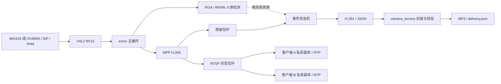

# 系统设计与运行基线

本文说明事件视频服务的功能范围、模块分工和设计取舍。[2026-11-08 运行记录](../../evidence/2026-11-08-event-service/README.md)对应 #57 基线；[2026-11-10 接入记录](../../evidence/2026-11-10-camera-integration/README.md)对应 #61，随后 IMX415 补丁构建的 #62 已默认启动，[修复记录](../../evidence/2026-11-10-imx415-drc-review/README.md)。各次源码、程序按文件指纹区分。

## 系统目标

在 RK3568 厂商 Linux BSP 上实现事件视频服务。候选配置选择 IMX415 或 OV8858 的 ISP/NV12 图像，支持手动事件与可选的人体检测事件，输出 H.264、JSON 和 MP4，并提供两个 RTSP 客户端的观看入口。OV8858 RAW 采集、mini3a 和 camd 为独立诊断与验证工具，运行模式与主服务分开。

单个主应用是一条视频链路供多个客户端观看。双路模式由两个独立主应用实例组成：分别采集、编码、录像并监听不同 RTSP 端口。有限联测中两路检测事件期间，两个 RTSP 回环客户端持续解码、两路 MP4 收尾并可解码，程序均记录 `target_left`；抽帧显示 IMX415 画面边缘仍有人体，因此该状态不能理解为整幅画面无人。[双路联测与边界](../../evidence/2026-11-11-dual-followup/event02-natural-close.md) · [状态观察](../../evidence/2026-11-11-dual-followup/README.md)

一个可复现的双路场景是让两枚相机分别观察入口和室内区域：每路对应自己的画面、事件与文件，并在需要时由客户端分别观看。不同型号用于验证两种传感器及其接入路径，不代表它们经过选型比较，也不引入帧同步、双目测距或跨画面跟踪。当前只是开发板上的能力验证，并非已部署的现场安防系统。

## 模块分工与设计取舍

| 模块 | 职责 | 取舍与限制 |
|---|---|---|
| IMX415 + ISP + rkaiq | 主应用图像来源；复用现有图像处理与曝光/白平衡控制，取得 NV12 供编码和模型预处理 | 不在主业务里重做 ISP；3A、IQ 和 BSP 需配套。录到视频不等于完整 IQ 调优。 |
| OV8858 + 自写 subdev + CIF/SDITF + ISP | 传感器驱动、RAW 诊断与彩色事件服务；参考 IQ 已启用 DRC | 可与 IMX415 并发采集，不代表帧同步或双目测距。IQ 借用参考模组配置，未做本模组标定；[DRC 对照](../image/drc-validation.md)只覆盖单场景。 |
| RAW10 保存与解释 | 保存原始传感器数据，供驱动出图、帧结构与后续离线分析 | 直接保存是有效交付；正常彩色显示还要解包与 Bayer 处理。灰度近似不能作为彩色检测效果。没有必要为该支路新建完整软件 ISP。 |
| mini3a | 独立的 AE 控制诊断与 ISP params 接口实验，把统计、决策、控制提交和后续帧响应显式展示 | 主业务使用 rkaiq。当前 AE 有真实响应；AWB 代码保留为实验，因本次 UV 恒中性未证明其图像效果，不作为主服务功能。 |
| V4L2 buffer | DQBUF 获得已完成 buffer；使用结束才 QBUF，避免 DMA 覆盖正在读取的内容 | evrec 复制到编码输入后归还，优先保证所有权简单；本版主应用不承诺全链路零拷贝。 |
| RGA + RKNN/NPU | 将 NV12 保持比例缩放为 RGB 并补边；使用 UINT8 输入、固定模型和 class 0/person，为事件录像提供自动触发 | 使用已有预训练模型及其输入/输出契约。逐项设置输出索引、检查大小，按类别概率与同类 NMS 后处理；单场景测试不构成准确率评价。 |
| MPP H.264 | 一次编码的数据供录像和网络分发，减少存储和传输量 | 原始视频不适合直接长期写盘/传输。与 ISP、NPU 职责不同，不为每个客户端重复编码。 |
| 录像环与事件状态 | 保留触发前数据，选择 IDR 起点；触发后流式追加，检测持续命中则续录，按 IDR 切段并有磁盘水位 | 单纯触发后才开摄像头丢失前情；无限缓存不可行。预录受容量和 GOP 约束，实际起点可提前到上一个 IDR。检测事件不等同于连续人员跟踪。 |
| RTSP 多客户端 | 控制协商与 RTP 承载分开；共享编码包环，客户端各自游标/线程，锁内复制、锁外发送 | 慢连接可丢过时帧、等待 IDR或断开；不能让慢连接长期持共享锁。两个客户端是本版验收目标，更多客户端不自动算通过。 |
| camd | 队列、引用计数、背压与推理输入路径的独立验证程序 | 不与 evrec 同时抢同一节点，不把 camd 双消费者队列写成 evrec 内部结构；不作为第二套生产服务。 |
| MP4 与交付记录 | 独立进程自动处理正常关闭的事件分段，核对 H.264/MP4 解码帧数并记录哈希和失败状态 | 采用包时间跨度换算的平均帧率，未保留逐帧采集时间；不能当作精确时间戳容器录制器。失败时保留原始文件。 |

## 数据通路与线程边界



采集、检测和编码采用一个串行主循环，使帧序号、触发时刻和事件状态归属清晰；推理或同步写盘耗时也会影响主循环吞吐。RTSP 网络发送在客户端线程中执行，慢网络不会一直占用共享包环的锁；磁盘、内存和调度仍有共享资源约束。异步处理需要额外管理队列容量、丢帧和 buffer 生命周期，应由吞吐或隔离需求决定。

所有权分三层：V4L2 buffer 在 RGA 读取和复制编码输入后才 QBUF；编码包复制进录像环/RTSP 环后可释放 MPP packet；RTSP 客户端在锁内复制 payload，锁外只发送自己的副本。`camd` 的引用计数队列是另一种共享原始帧的实现，不属于 `evrec` 的内部数据通路。

录像中的 `.part` 只表示进行中或未正常收尾；原始 JSON 在写入及关闭成功后原子发布。`.h264`、JSON、进程退出码和完整解码需要一起判断，封装结果另记 `.delivery.json`。`fclose` 成功不提供断电持久性保证。本版使用外部工具自动封装 MP4；双路融合、完整 ISP、旧 `realdetect.c` 和历史性能实验不属于主服务接口。

事件预录依赖编码包缓存，切片与客户端起播依赖 IDR 和参数集，客户端私有副本用于缩短共享锁的持有时间。写入和收尾错误向调用方传播，避免把不完整事件报告为成功。双传感器接入、mini3a 控制环与 camd 并发队列各自验证不同接口，状态分别记录。

## 主应用入口

配置为 [`config/final-demo.env`](../../config/final-demo.env)，显式指定 1080p、4 Mbps、pre=3 s、post=2 s、64 MiB 录像环预算、30 s 分段目标、两个 RTSP 客户端，以及检测门限。IDR 边界可使实际分段长于目标值；这些参数是固定配置，不是性能保证。

```sh
make apps
sh tools/run_camera_demo.sh ov8858-isp manual /root/new-manual-run
# 预热后，在另一终端更新 /root/new-manual-run/trigger 的时间触发
# 检测模式另选隐私安全的场景，使用新的运行目录：
sh tools/run_camera_demo.sh imx415-isp detect /root/new-detect-run
# 两路并发，每路独立目录与端口；向进程发送 SIGTERM 正常收尾
python3 tools/run_dual_camera.py manual /root/new-dual-run
# 分别触发 /root/new-dual-run/imx415/trigger、/root/new-dual-run/ov8858/trigger
```

双路管理器对两个实例采用共同生命周期：任一路提前退出时通知另一条停止并将整体标为失败，正常停止后写入 `status.json`。它不合并码流、不同步相机，也不提供自动重启。`detect` 模式完成过有限联合观察；事件结束基于程序检测状态，不能推断整幅画面没有人，长期运行仍待验证。

启动器只检查、记录并运行独立应用，不改服务或启动配置。先确认现役环境和设备无人占用；后台运行按维护约定使用 nohup/disown，保留 stdout/stderr 和退出码。手动事件、自动事件分别验收，手动触发成功不能代替模型检测成功。

本次候选应用目录为 `/root/camera-integration-20261110-app`，历史 #57 目录为 `/root/camera-service-final`；先核对内核、设备拓扑和板钟，重启后时钟可能回到出厂时间。主服务依赖 Python 3、FFmpeg/FFprobe、匹配的 3A 与模型。使用新的绝对运行目录，不覆盖既有录像。

## 历史 #57 验证范围

| 验收 | 本轮要确认什么 | 当前状态 |
|---|---|---|
| 环境与版本 | 源码/程序/模型/配置/库/内核指纹及默认启动 | #57 默认启动确认，3A 正常自启，指纹已记录 |
| 手动事件 | 预录/后录、文件收尾、自动 MP4、解码帧数一致 | #57 通过；双客户端与慢端隔离的具体版本见运行记录 |
| 人体事件 | 无人/入镜/离开、触发/分段/结束与 MP4 交付 | 最终应用在 #57 场景通过；先前失败和误触发记录保留，不声称准确率 |
| OV8858 支路 | 识别、控制、RAW、ISP 与事件服务 | #61 候选经 ISP 完成有限短测；#60 控制回读与 RAW 变化，参考 IQ 未标定 |
| mini3a 工具 | 独占环境的控制和输出 | #57 AE 与 params 通路通过；AWB 图像效果未验证 |
| camd 工具 | 实际采集、消费者和 buffer 归还 | #57 默认模式 60 帧正常退出、60 帧归还 |
| 错误与退出 | 写盘错误不能假报成功；停止后设备空闲 | 板端三类注入通过，writer 函数与最终应用相同；最终主机回归通过 |

表中除 OV8858 行外为 11 月 8 日 #57 的历史基线，不能自动继承到 #61。#61 的两种相机独立手动录像、双客户端回环和 OV 人体触发见[新记录](../../evidence/2026-11-10-camera-integration/README.md)；记录以文件内容标识源码，不把未提交工作树等同于基准提交。

## 部署与恢复

默认 `/boot/Image-4.19.232` 为 #62，DTB 沿用 #61；正常重启及两台相机分别手动事件短测见[修复记录](../../evidence/2026-11-10-imx415-drc-review/README.md)。#61 恢复 Image 保留在 `/boot`，#57 Image 备份保留在板端根分区和电脑，#57 DTB 备份保留在 `/boot`；复现前仍须核对镜像、设备树、IQ 和 3A 环境。

mini3a 使用一次性引导参数隔离 3A；该参数未保存，正常启动已恢复。没有改 bootloader、分区或持久服务配置。变更与恢复仍按维护约定记录备份、校验和结果。
