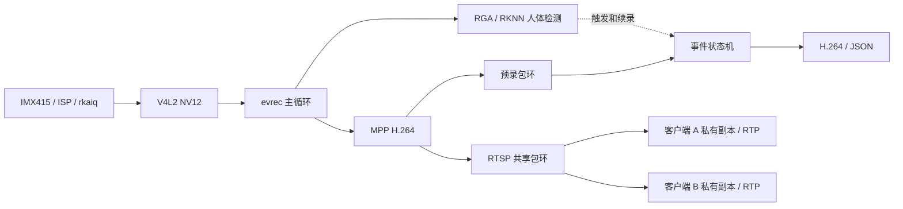

# 最终系统设计与版本确定

本页决定本项目最终展示什么、模块为什么存在、验收通过后以哪个版本准备面试。它说明本版的设计取舍，不倒推过去每一步都基于完整产品需求。**当前仍是候选，尚未完成本轮板端验收，不称为已冻结。**

## 系统目标

在 RK3568 厂商 Linux BSP 上实现一条可观察、可回放的事件视频服务，同时完成另一种传感器的驱动接入与 RAW 采集验证。主应用使用 IMX415 的 ISP/NV12 图像，支持手动事件与可选的人体检测事件，输出 H.264+JSON，并提供两个 RTSP 客户端的实时观看入口。OV8858、mini3a、camd 是有独立职责的驱动/诊断工具，不强行拼成同时运行的业务依赖。

## 每部分存在的理由

| 部分 | 本版职责与为什么保留 | 为什么不用其他方案；限制 |
|---|---|---|
| IMX415 + ISP + rkaiq | 主应用图像来源；复用现有图像处理与曝光/白平衡控制，取得 NV12 供编码和模型预处理 | 不在主业务里重做 ISP；3A、IQ 和 BSP 需配套。录到视频不等于完整 IQ 调优。 |
| OV8858 + 自写 subdev + CIF | 另一条传感器/接收链路的驱动验证：I²C、上电/PM、格式协商和 RAW10 采集 | 事件录像本身不需要两台相机。双路在这里用于验证两类相机链路，不声称立体视觉、融合、同步双目或双路彩色服务。 |
| RAW10 保存与解释 | 保存原始传感器数据，供驱动出图、帧结构与后续离线分析 | 直接保存是有效交付；正常彩色显示还要解包与 Bayer 处理。灰度近似不能作为彩色检测效果。没有必要为该支路新建完整软件 ISP。 |
| mini3a | 可单独执行的 AE/AWB 控制诊断工具：把统计、决策、控制提交和后续帧响应显式展示，帮助分辨控制通路与厂商算法/版本问题 | 主业务已有 rkaiq，不需要同时再跑 mini3a。它不是厂商 3A 替代品，也不实现 AF；仅以简单场景和明确指标验收。 |
| V4L2 buffer | DQBUF 获得已完成 buffer；使用结束才 QBUF，避免 DMA 覆盖正在读取的内容 | evrec 复制到编码输入后归还，优先保证所有权简单；本版主应用不承诺全链路零拷贝。 |
| RGA + RKNN/NPU | 把 NV12 缩放/转换为固定模型输入，运行已有模型并解码结果，为事件录像提供自动触发 | 不是自行训练或创造检测算法；固定模型及 class 0/person。推理慢、误检漏检需观察，不能只看接口成功就宣称有效检测。 |
| MPP H.264 | 一次编码的数据供录像和网络分发，减少存储和传输量 | 原始视频不适合直接长期写盘/传输。与 ISP、NPU 职责不同，不为每个客户端重复编码。 |
| 录像环与事件状态 | 保留触发前数据，选择 IDR 起点；触发后流式追加，目标持续则延长，按 IDR 切段并有磁盘水位 | 单纯触发后才开摄像头丢失前情；无限缓存不可行。预录受容量和 GOP 约束，实际起点可提前到上一个 IDR。 |
| RTSP 多客户端 | 控制协商与 RTP 承载分开；共享编码包环，客户端各自游标/线程，锁内复制、锁外发送 | 慢连接可丢过时帧、等待 IDR或断开；不能让慢连接长期持共享锁。两个客户端是本版验收目标，更多客户端不自动算通过。 |
| camd | 队列、引用计数、背压与推理输入路径的独立验证程序 | 不与 evrec 同时抢同一节点，不把 camd 双消费者队列写成 evrec 内部结构；不作为第二套生产服务。 |
| MP4 演示 | 由已完成 H.264 文件封装供浏览器查看，帧数与解码结果要核对 | 当前工具使用假定固定帧率，不能当作准确保留采集时间的容器录制器。 |

## 一条主线，而不是把实验拼成产品



本版有意保留一个串行采集/检测/编码主循环，使帧序号、触发时刻和事件状态归属清晰；这也意味着推理或同步写盘耗时会影响主循环吞吐。RTSP 网络发送在客户端线程中执行，慢网络不会一直占用共享包环的锁；这不等于磁盘、内存和调度上的故障互相隔离。需要更高吞吐或写盘隔离时才值得增加异步队列，而不是为展示多线程把所有步骤拆线程。

所有权分三层：V4L2 buffer 在 RGA 读取和复制编码输入后才 QBUF；编码包复制进录像环/RTSP 环后可释放 MPP packet；RTSP 客户端在锁内复制 payload，锁外只发送自己的副本。`camd` 的引用计数队列用于学习另一种共享原始帧的设计，不能拿它替代对本程序实际路径的解释。

录像中的 `.part` 只表示进行中或未正常收尾；`.h264`、JSON、进程退出码和完整解码需要一起判断。`fclose` 成功不提供断电持久性保证，本版不承诺掉电恢复。原生 MP4、双路融合、完整 ISP、旧 `realdetect.c` 和历史性能实验不属于本版交付接口；保留源码与历史记录不表示这些都要补成产品。

面试解释以“为什么要保留触发前数据 → 为什么编码后缓存 → 为什么按 IDR 起播/切片 → 为什么客户端私有副本 → 故障怎样向上报”为主线。双路、mini3a 和 camd 分别作为驱动差异、控制闭环、并发所有权的独立例子，不说成主业务缺一不可。

## 当前唯一主应用入口

配置为 [`config/final-demo.env`](../../config/final-demo.env)，显式指定 1080p、4 Mbps、pre=3 s、post=2 s、64 MiB 录像环、30 s 分段、两个 RTSP 客户端，以及检测门限。参数是可复核的演示配置，不是性能保证；板测若需改变，先说明原因，再形成新的候选，不能改完阈值回填“通过”。

```sh
make apps
sh tools/run_camera_demo.sh manual /root/new-manual-run
# 预热后，在另一终端更新 /root/new-manual-run/trigger 的时间触发
# 检测模式另选隐私安全的场景，使用新的运行目录：
sh tools/run_camera_demo.sh detect /root/new-detect-run
```

启动器只检查、记录并运行独立应用，不改服务或启动配置。先确认现役环境和设备无人占用；后台运行按维护约定使用 nohup/disown，保留 stdout/stderr 和退出码。手动事件、自动事件分别验收，手动触发成功不能代替模型检测成功。

## 本轮验收与冻结条件

| 验收 | 本轮要确认什么 | 当前状态 |
|---|---|---|
| 环境与版本 | 固定源码提交、程序/模型/配置/库/内核镜像指纹；运行内核与待讲源码对应 | 只读已确认板端 #52、3A 存活；当前源码的新候选尚未永久部署，待处理 |
| 主业务手动事件 | 新鲜帧、预录/后录、IDR、文件收尾及完整解码；两客户端并发；单个慢客户端不阻断正常客户端 | 待本轮验证 |
| 人体事件 | 明确正/负场景，证明输入新鲜、正向命中、移走后结束；保留误检/漏检，不凭一次运行声称检测准确率 | 待本轮验证 |
| OV8858 支路 | 当前驱动识别、开停流、原始帧大小/布局与数据变化；双路短时采集 | 待本轮验证；此前临时启动仅作已有参考 |
| mini3a 工具 | 在无冲突环境中限 300 帧；达到程序现有判据且输出可用，或如实说明不收敛及原因 | 主机测试和交叉构建已通过，板测待执行 |
| camd 工具 | 当前源码完整构建、真实设备短跑及 buffer 归还，限定已测模式 | 待本轮验证 |
| 错误与退出 | 主机故障测试绿；关键写盘失败不能假报成功；停止后不残留采集进程 | 主机记录已有，板端关键路径待验证 |

完成后在本页追加**冻结的代码提交、配置/程序与运行环境指纹及本轮证据路径**，同步 README 与面试学习入口。源码和运行状态未对应、正向功能未验证时，继续称为候选。被冻结的是明确范围内的版本，不是宣称不存在任何 bug；以后只有修复真实问题或用户明确要求才改变基线。

## 当前需要单独授权的硬件操作

板端现为 #52，而当前 OV8858 源码已不同，不能用 #52 出图替新驱动作证。#56 候选 Image 已在独立 VM 树构建并核对到板端独立目录，应用也已使用板端头文件/库完整构建，见[准备记录](../../evidence/2026-11-08-final-system/README.md)。尚未覆盖 `/boot` 或启动新内核。

拟先临时引导 #56，在正常 3A 环境验主业务与 RAW 支路；再以一次性屏蔽 3A 自启动的引导参数单独验证 mini3a；通过后才切换默认镜像并重启确认。保持旧镜像备份，不改 bootloader、分区或持久服务配置。部署、重启及服务启动环境的变更须先获明确授权。冻结条件是上述有限范围的功能/错误路径实测和版本对应，不是补完所有历史实验或证明没有任何缺陷。
