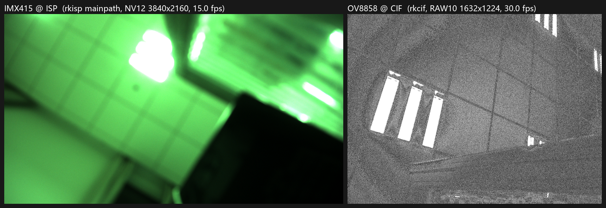

# 双摄采集实验

> **验收**:① 一张双路预览图 ② 带宽/负载数据表 ③ 两路不同格式的消费者设计
> **历史结论的适用范围**:在本次短时对照中，两路单独和并发采集时工具显示的帧率相同；这不能证明系统不存在共享资源或相互影响。内存写入量按帧大小和帧率估算，并非 DDR 实测带宽。第 7 节双路 NPU 的逐次原始日志尚未在仓库中定位，数字仅保留为历史汇总。

---

## 1. 硬件拓扑

| 项 | CAM0(IMX415) | CAM1(OV8858) |
|---|---|---|
| 座子 | J10 | J11 |
| I2C | i2c1 | i2c5 |
| D-PHY | csi2-dphy1(split) | csi2-dphy2 |
| 后端 | **rkisp**(→ NV12) | **rkcif**(→ RAW10) |
| 设备节点 | `/dev/video5`(rkisp_mainpath) | `/dev/video0`(stream_cif_mipi_id0) |
| 分辨率 / 帧率 | 3840×2160 @ 15.0 fps | 1632×1224 @ 30.0 fps |
| 格式 | NV12(ISP 出图) | compact RAW10(每 5 字节 4 像素) |
| 驱动 | 厂商 `imx415` | **我们自写的 `ov8858_sm`**(见 `driver/ov8858_sm/`) |



左 = IMX415 经 ISP 出 NV12(偏绿是因为没跑 AWB);右 = OV8858 的 RAW10 解包(灰度)。两个模组看的是同一片天花板,安装角度不同。

---

## 2. 双路同时开流:采集层速率对照

本节对照的是采集层帧率等指标;两路接入 NPU 后存在争用,见 §7,不应将本节结论推广到推理层。

工具:`zerocopy/capbench.c`(固定时长数帧,自报 fps / 每帧耗时 / 进程 CPU)

```
./capbench /dev/video0 8 1632 1224 BG10
./capbench /dev/video5 8 3840 2160 NV12
```

| 场景 | OV8858(CIF) | IMX415(ISP) |
|---|---|---|
| 单路 | **30.02 fps**,33.31 ms/帧 | **15.00 fps**,66.67 ms/帧 |
| 双路并行 | **30.02 fps**,33.31 ms/帧 | **15.00 fps**,66.67 ms/帧 |
| 变化 | **0%** | **0%** |

**本次工具显示的两路帧率相同。** 两路使用不同的 I²C、D-PHY 和采集后端，但仍可能共享内存、总线或其他系统资源；不能由这组显示值推导“没有共享资源”或所有负载下均无干扰。

---

## 3. 带宽与负载数据表

### 3.1 采集统计与估算(按 `sizeimage × fps` 算)

| 通道 | 分辨率 | 格式 | 每帧字节 | fps | **估算写入量** | 进程 CPU |
|---|---|---|---|---|---|---|
| IMX415 | 3840×2160 | NV12 | 12,441,600(11.87 MiB) | 15.00 | **178.0 MiB/s** | 3.1–3.2 ms/帧(4.6%) |
| OV8858 | 1632×1224 | RAW10 | 2,506,752(2.39 MiB) | 30.02 | **71.8 MiB/s** | 0.7 ms/帧(2.0%) |
| **合计** | — | — | — | — | **249.8 MiB/s** | **≈6.6% 单核** |

> CPU 只是"采集进程"的 CPU(纯 DQBUF/QBUF,不做数据处理);ISP/CIF 的内核线程另计,实测整机在双路空转时约 5–8%。

### 3.2 计算(链路侧)

| 通道 | 像素率 | 原始数据率(10bit) | Lane 数 / 单 lane | 链路利用率 |
|---|---|---|---|---|
| IMX415 | 3840×2160×15 = 124.4 Mpx/s | 1.244 Gbps | 2 lane × 622 Mbps | 视 dphy1 配置(2-lane 720M 上限时 ≈86%) |
| OV8858 | 1632×1224×30 = 59.9 Mpx/s | 599 Mbps | 2 lane × 300 Mbps | **41.6%**(配置 720 Mbps/lane) |

### 3.3 结论

- 按帧大小和帧率估算两路写入量合计约 **249.8 MiB/s**；没有直接测量 DDR 总带宽，不能单凭估算排除内存瓶颈。
- 本配置使用 ISP 与 CIF 两条不同采集路径；ISP 资源及各自 MIPI 链路速率仍是设计约束。
- CPU 数字来自对应采集进程，不能仅凭它们比较完整 ISP/CIF 硬件流水线的开销。

---

## 4. 两路不同格式的消费者设计

这是异构双摄最实际的部分:**NV12 和 RAW10 的消费路径完全不同**。

### 4.1 NV12(IMX415,rkisp 输出)

```
/dev/video5 (NV12 3840×2160)
   ├─[A] 零拷贝分析:v4l2 EXPBUF → dmabuf → RGA 缩放/色彩 → NPU(yolov8)     ← 已实现(zerocopy/)
   ├─[B] 编码:H.264/H.265 硬件编码器(MPP),用于录像/推流
   └─[C] 显示:DRM(card0)直接 import dmabuf 上屏,全程零拷贝
```
特点:**格式友好**,三种消费者都能零拷贝接入;RGA 可直接吃 NV12,NPU 需要 RGB 时由 RGA 转。

### 4.2 RAW10(OV8858,rkcif 输出)

```
/dev/video0 (compact RAW10 1632×1224, 每 5 字节 4 像素)
   ├─[A] 存盘/回放:直接落盘,CPU 几乎为 0(采集进程 0.7 ms/帧)——适合"原始记录"
   ├─[B] 转 NV12:两条路
   │     B1 尝试重新走 ISP——与 IMX415 的资源和并发关系需要另行验证
   │     B2 CPU 解包 5:4 → 10bit → RGA → RGB → NPU
   │        包含约 2.5 MB/帧的位操作;批量解包性能取决于实现和平台(见 §5)
   └─[C] 直接喂 NPU:不行,模型要 RGB/uint8,RGA2 也不支持 RAW10 解包
```

**设计结论(也是这块板子的关键事实)**:

1. 本项目采用一路 ISP、一路 CIF 的双摄配置。单 ISP 是本板设计约束；是否存在其他并发配置、以及 CIF 数据能否经后处理转成 NV12，需要针对具体路径验证，不能据此称本方案是唯一可行架构。
2. 于是分工很自然:
   - **ISP 那一路做"分析"**(NV12 → 零拷贝 → RGA → NPU,CPU 最低)
   - **CIF 那一路做"原始记录"**(RAW10 落盘,CPU 几乎为 0),需要分析时再单独解包
3. 如果两路都要分析:OV8858 走 B2(CPU 解包),预计比 ISP 路径多 3–8 ms/帧的 CPU——这就是"异构"的真实代价,值得在方案评审里讲清楚。

---

## 5. 复现命令

```bash
# 前置:OV8858 走 rkcif(media0),必须先设 sensor pad
media-ctl -d /dev/media0 --set-v4l2 '"ov8858-sm 5-0036":0[fmt:SBGGR10_1X10/1632x1224]'

# 双路同时开流(各 8 秒,各自报 fps/CPU/带宽)
./capbench /dev/video0 8 1632 1224 BG10 &
./capbench /dev/video5 8 3840 2160 NV12 &
wait

# 双路各抓一帧做预览
v4l2-ctl -d /dev/video0 --stream-mmap --stream-count=3 --stream-to=/tmp/dual_cif.raw &
v4l2-ctl -d /dev/video5 --stream-mmap --stream-count=3 --stream-to=/tmp/dual_isp.raw &
wait
```

---

## 6. 与路线图的关系

L3 原本排在 L1-B/零拷贝之后作为"储备",这次**提前做掉**,因为地基是现成的:

- OV8858 的驱动是 L1-B 自写的,已经在 rkcif 上跑
- IMX415 的 ISP 链路是 L1-A 打通的
- 两路的媒体拓扑互不重叠,`media0`(rkcif)与 `media1`(rkisp)各自独立

**下一步可选**:
1. 双路都接 NPU:IMX415 走零拷贝分析 + OV8858 解包后分析,测两路并行的 NPU 争用
2. 把 OV8858 也切到 rkisp,量化"单 ISP 争用"到底损失多少(反向验证 §4.2 的结论)
3. 双路录像:MPP 编码 IMX415 + RAW10 落盘 OV8858,做车载/安防式双路记录

---

## 7. 双路都接 NPU:争用实测(2026-10-21,对应"下一步 1")

工具:`zerocopy/zc_dual.cpp`

- **通道 A**:IMX415 NV12 3840×2160 → EXPBUF dmabuf → RGA → 640×640 → NPU(与零拷贝链路同构)
- **通道 B**:OV8858 RAW10 1632×1224 → memcpy → **解包 5:4 成灰度**(5 字节取前 4 字节即高 8 位)→ RGA(YCbCr_400→RGB)→ NPU
- 两路各用独立 rknn context,两个线程,同时跑

### 7.1 数据

> 本节保留历史报告记录;当前仓库的 `evidence/` 中未找到该次双路推理的原始运行日志,表中数字暂不能从原始日志独立复核。

| 场景 | IMX415 | OV8858 | 聚合 | 进程 CPU |
|---|---|---|---|---|
| 单路 A | **14.38 fps**,每帧 64.6 ms,NPU 41.0 ms | — | 14.38 inf/s | 18.2% |
| 单路 B | — | **17.24 fps**,每帧 56.4 ms,NPU 40.7 ms | 17.24 inf/s | 28.3% |
| **双路** | **9.57 fps**,每帧 100.9 ms,NPU **77.1 ms** | **9.47 fps**,每帧 103.8 ms,NPU **72.9 ms** | **19.04 inf/s** | 30.3% |

### 7.2 结论

1. **历史汇总显示并发时推理调用墙钟增加。** 这是 NPU 资源争用的一种可能表现；逐次原始日志缺失，不能仅凭这张表证明唯一瓶颈或调度机制。
2. 历史汇总中的双路聚合吞吐低于单路推算上限；差异可能涉及调度和其他开销，具体原因未完成对照验证。
3. 这次汇总里的两路全帧需求高于记录的聚合推理吞吐；换模型、分辨率或负载后不能直接套用。
4. 这次汇总的两路帧率接近；不能据单次汇总证明长期公平或排除饥饿。
5. 进程 CPU 仅覆盖该统计口径，不能据此排除系统其他 CPU 开销或断定唯一瓶颈。

### 7.3 工程上怎么办

| 方案 | 说明 |
|---|---|
| **降帧率分析** | 每 N 帧取一帧推理可以减少需求，但可能增加目标出现到被检测到的等待时间 |
| **降分辨率/小模型** | 可作为候选方案；吞吐和精度需要在实际模型及负载下测量 |
| **一路分析 + 一路记录** | 正是 §4 的异构分工:ISP 那路做分析(19 inf/s 够用),CIF 那路只落盘 |
| **多 NPU 平台** | RK3588 有 3 个 NPU 核,这类需求应该选它;RK3568 的定位就是单路分析 + 多路采集 |

> 这些是候选设计方向，不是对 RK3568 所有模型和负载的能力上限结论；需要结合实际模型、帧率与精度要求验证。
